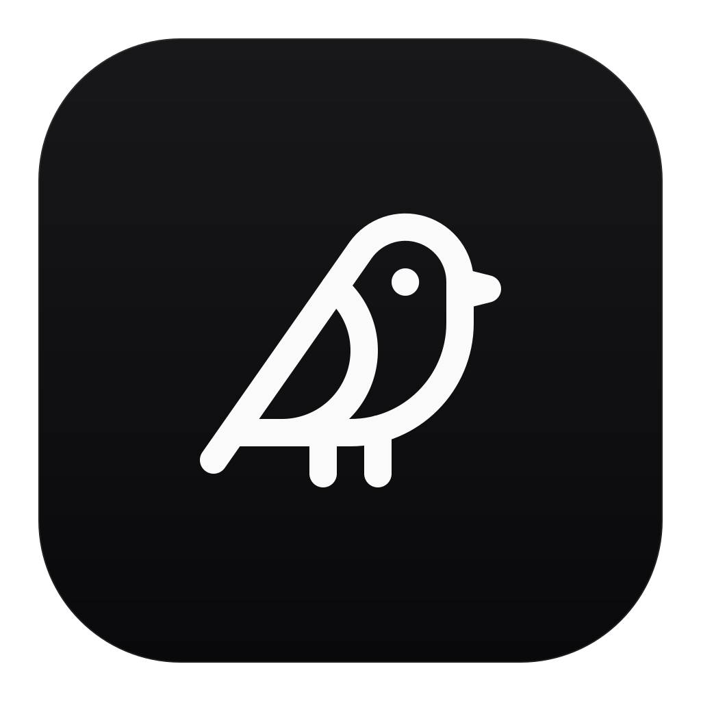
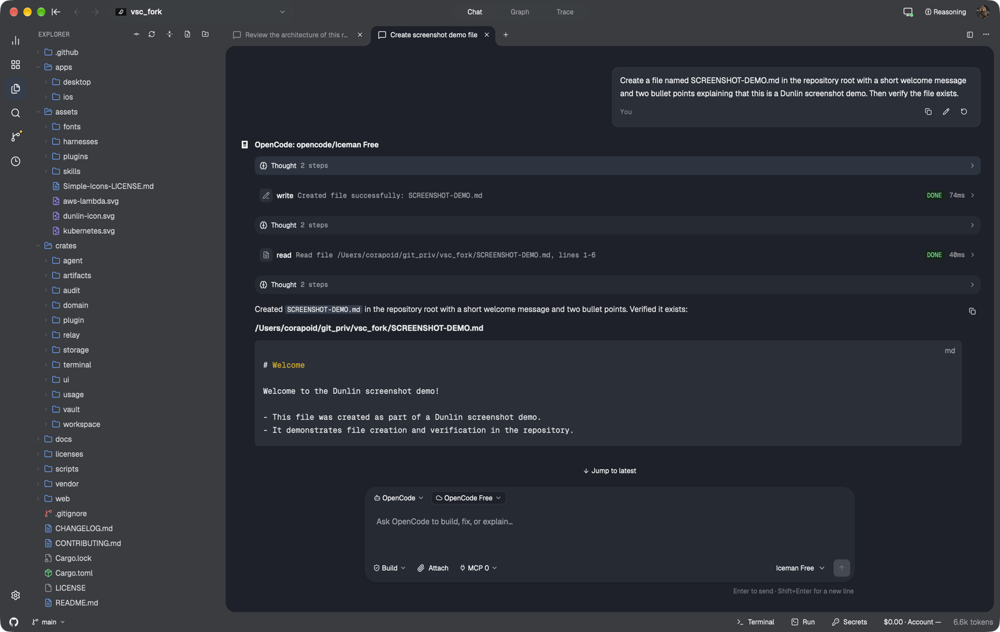
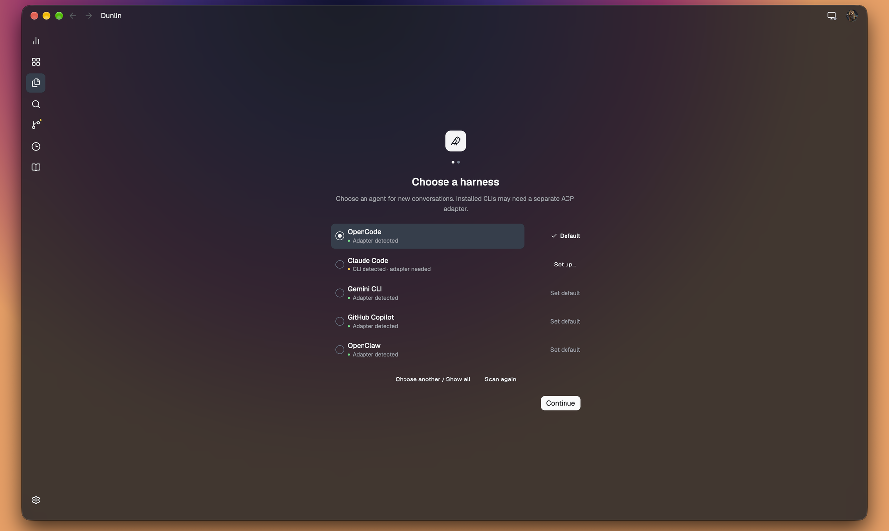
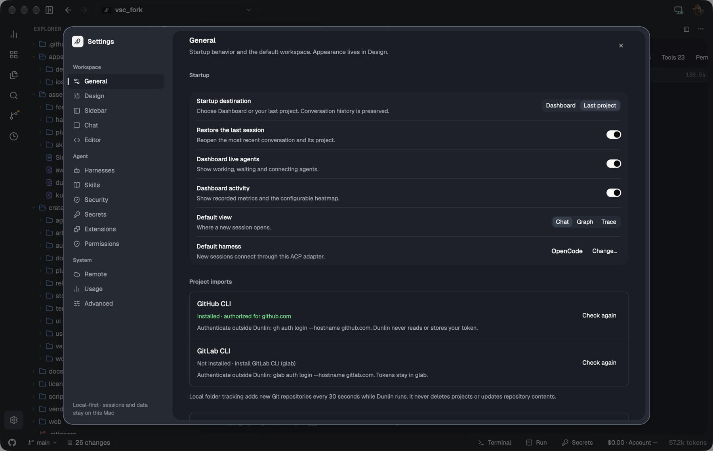
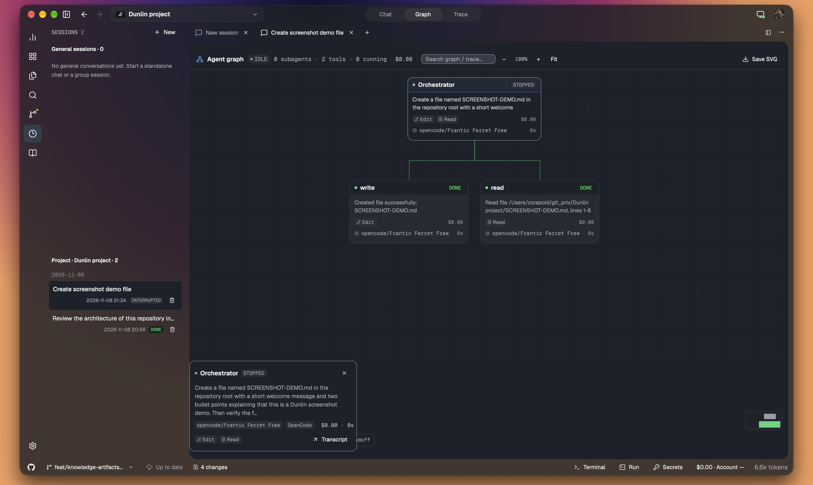
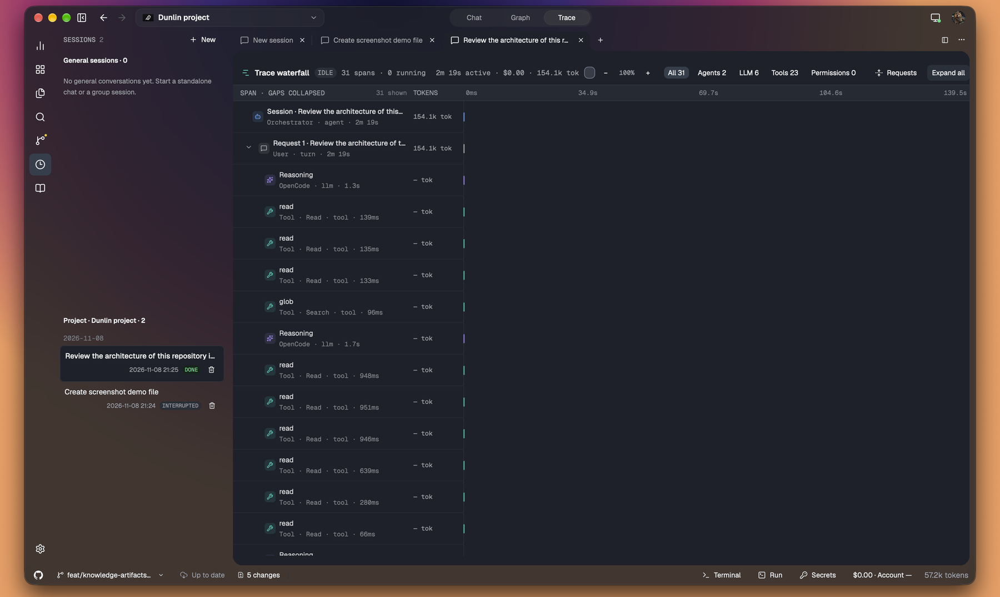

<p align="center">
  
</p>

<h1 align="center">Dunlin</h1>

<p align="center">
  <b>A native, agent-first IDE for macOS.</b><br/>
  Rust + GPUI. No Electron, no browser runtime, no cloud account.
</p>

<p align="center">
  
  
  
  <a href="https://github.com/corapoid/dunlin/actions/workflows/ci.yml"></a>
</p>

<p align="center">
  
</p>

Dunlin is a calm, keyboard-driven workspace for coding with agents. It speaks
the **Agent Client Protocol** directly, so tool calls, plans, diffs and permission
requests are native UI — not terminal text to parse. Projects, sessions and
history stay on your Mac.

**0.1.0-beta.8** · macOS 15+ · Apple Silicon · local + self-hosted relay

## What you won't find combined anywhere else

- **One native ACP surface for every agent.** OpenCode, Claude Code, Codex,
  Gemini, Copilot, Cursor, custom ACP adapters — with structured tool cards,
  permission gates, plans, diffs and subagent context in one UI.
- **A real agent workspace, not a chat box.** Queue prompts while a turn runs,
  edit or retry messages, resume history, and keep per-project/group harness,
  model and environment defaults.
- **Live Graph and Trace.** Every request, model call, tool and permission is
  projected from the actual transcript — not a mock, estimate or demo view.
- **Your history comes with you.** Import Claude Code, Codex and OpenCode
  sessions locally, including per-turn tokens and file-diff counts, with no
  cloud upload.
- **Use-only credentials.** Short-lived API keys stay in the macOS Keychain;
  agents can request an allowlisted HTTPS call, a named policy operation or a
  fixed CLI recipe, but never receive the value. Auto-approved only within the
  key's host/method/grant scope, with optional per-use approval and a separate
  relay-side vault.
- **A native Git workbench.** Graph/history, stash, worktrees, merge/rebase/
  cherry-pick, inline blame, GitHub CI/PR and AI-assisted Conventional Commits.
- **Visual Markdown that is still a real editor.** Editable blocks, tables,
  code fences, raw mode, undo and save — no embedded browser or Monaco.
- **A self-hosted relay.** Pairing codes, Keychain tokens, session takeover,
  transcript snapshots and a macOS seatbelt around remote harnesses.
- **A terminal that goes the distance.** Local PTY, relay and SSH transports,
  draggable splits, mouse selection, OSC 8 links and zsh/bash shell integration
  with command/output actions.
- **Two-step onboarding and a macOS permission center.** No account, no telemetry,
  no bundled model, and no pretending that TCC permissions were granted.

Individually some of these exist elsewhere; the combination in one native
Rust/GPUI app is the unusual part.

## Fast, native, lean

Measured on an Apple M1 / 16 GB / macOS 27.0.1 with the release build, no agent
connected, median of three warm launches:

| | |
| --- | ---: |
| First window, empty onboarding | **0.31 s** |
| First window, local project | **0.30 s** |
| First window, 1,748-file project | **0.32 s** |
| Idle memory, empty | **99 MiB** |
| Idle memory, project workspace | **103–106 MiB** |
| Idle CPU | **0.4%** |
| App executable | **42.4 MiB** |

First launch after install was 1.07 s on the same machine because of cold
filesystem and Gatekeeper work. There is no Electron, Chromium, Node runtime or
Monaco in the running app; the UI is GPUI and the data layer is local SQLite.
Long transcripts open as a bounded 120-item window, and file, Git, language and
icon scans run off the UI thread with debounced refreshes.
The exact method and caveats are in [`docs/performance.md`](docs/performance.md).

## Start

Install the current beta with Homebrew:

```sh
brew trust corapoid/tap
brew install --cask corapoid/tap/dunlin@beta
```

Or download the DMG, `.pkg` installer or ZIP from the
[releases page](https://github.com/corapoid/dunlin/releases), or build it:

```sh
git clone https://github.com/corapoid/dunlin.git
cd dunlin
./scripts/bundle-macos.sh --build
open dist/Dunlin.app
```

Requirements: macOS 15+, Apple Silicon, Rust 1.92+ (`rustup`), and an ACP
harness such as `opencode acp`. Development runs with `cargo run -p dunlin`.

The current beta is ad-hoc signed and not Apple-notarized; the `.pkg` installer
is unsigned. macOS may ask you to approve the app in
**System Settings → Privacy & Security**.

## A quick look

<table>
  <tr>
    <td width="50%" valign="top">
      
      <br/><sub><b>Open a folder.</b> No demo projects or hidden workspace.</sub>
    </td>
    <td width="50%" valign="top">
      
      <br/><sub><b>Make it yours.</b> Flat settings, themes, permissions and TCC.</sub>
    </td>
  </tr>
  <tr>
    <td width="50%" valign="top">
      
      <br/><sub><b>See the plan.</b> Agents, tools and subagents as a live graph.</sub>
    </td>
    <td width="50%" valign="top">
      
      <br/><sub><b>See the time.</b> Requests, tools and permissions as trace spans.</sub>
    </td>
  </tr>
</table>

## Learn more

- [Full guide](docs/guide.md) — the detailed feature and operations reference.
- [Roadmap](docs/ROADMAP.md) and [remaining work](docs/REMAINING-WORK.md).
- [Changelog](CHANGELOG.md) · [Performance methodology](docs/performance.md).
- [Session import](docs/session-import.md) · [Markdown editor](docs/markdown-editor.md) · [Remote relay](docs/guide.md#remote-relay).
- [R11 manual QA matrix](docs/r11-qa.md) · [Security](SECURITY.md) · [Contributing](CONTRIBUTING.md).

## Status

Dunlin is an early public beta. The iOS client is a scaffold, not part of this
release. Intel Macs are not supported in 0.1. See the
[roadmap](docs/ROADMAP.md) for what is built and what is still open.

## License

MIT — see [LICENSE](LICENSE). Bundled fonts and dependencies are listed in
[`THIRD_PARTY_NOTICES.md`](THIRD_PARTY_NOTICES.md).
