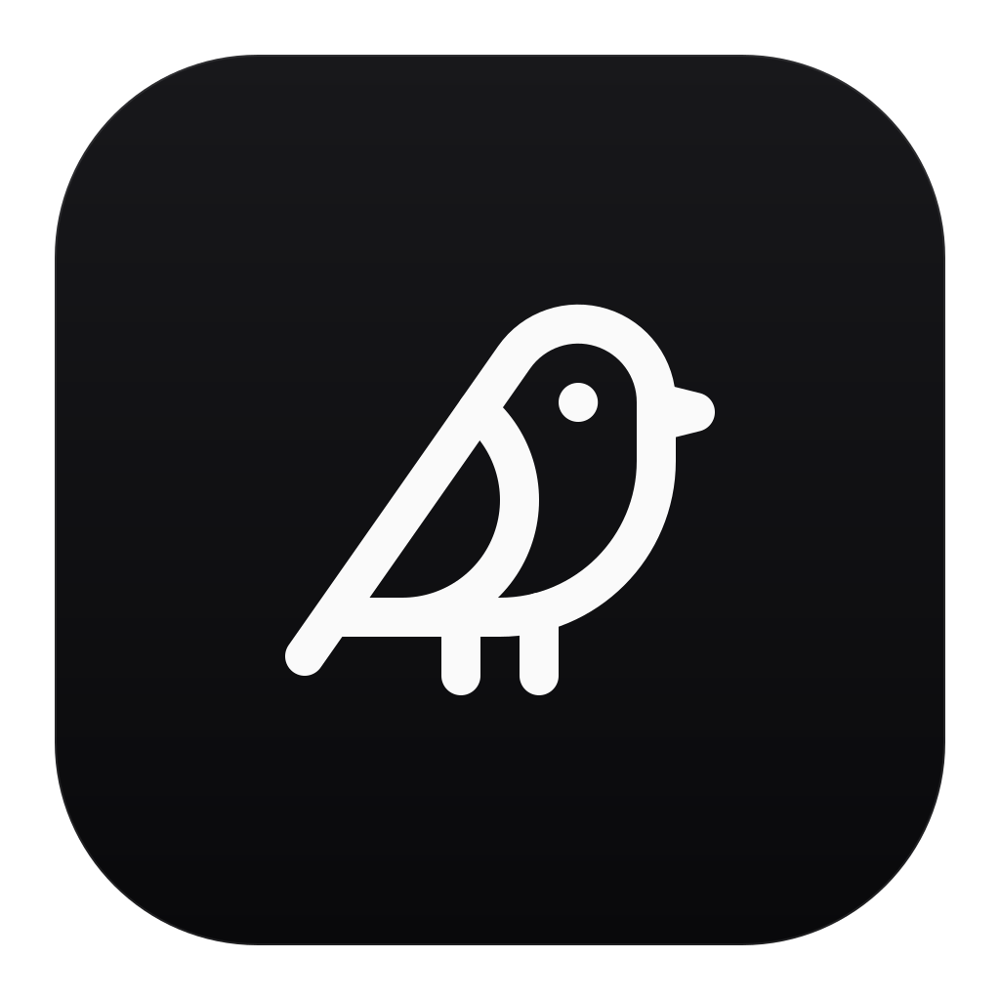
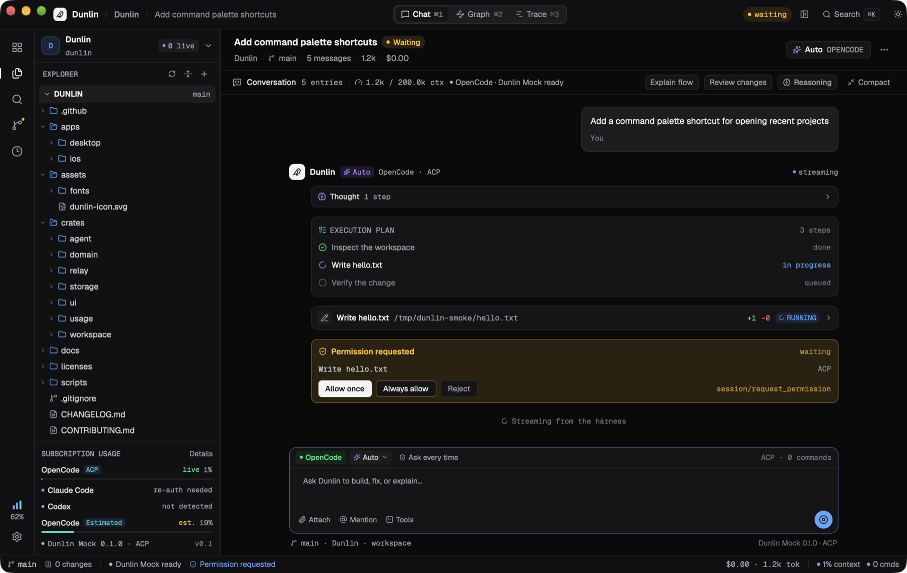
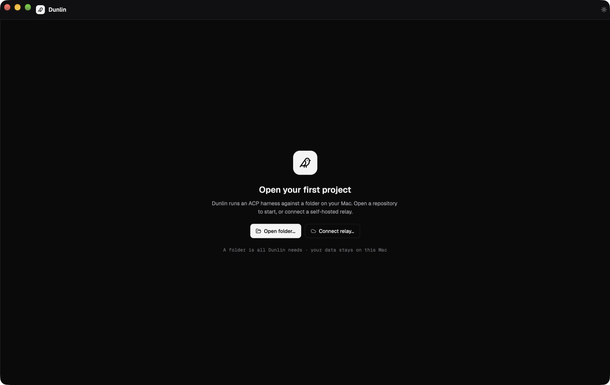
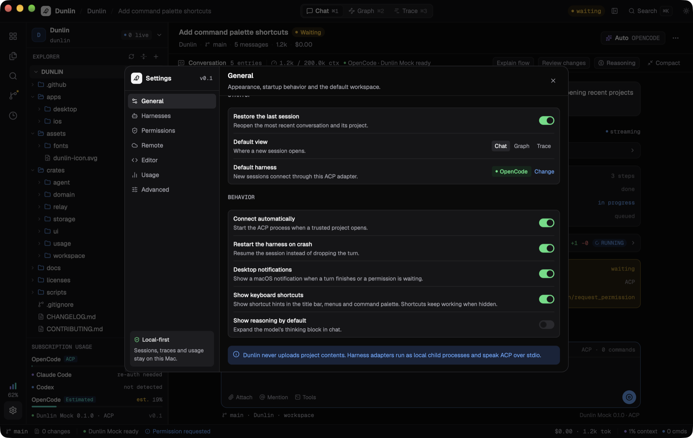
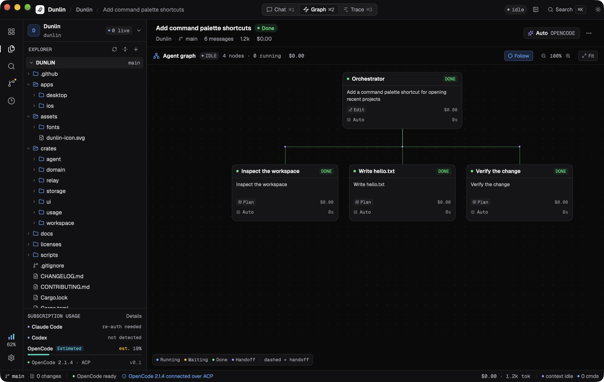
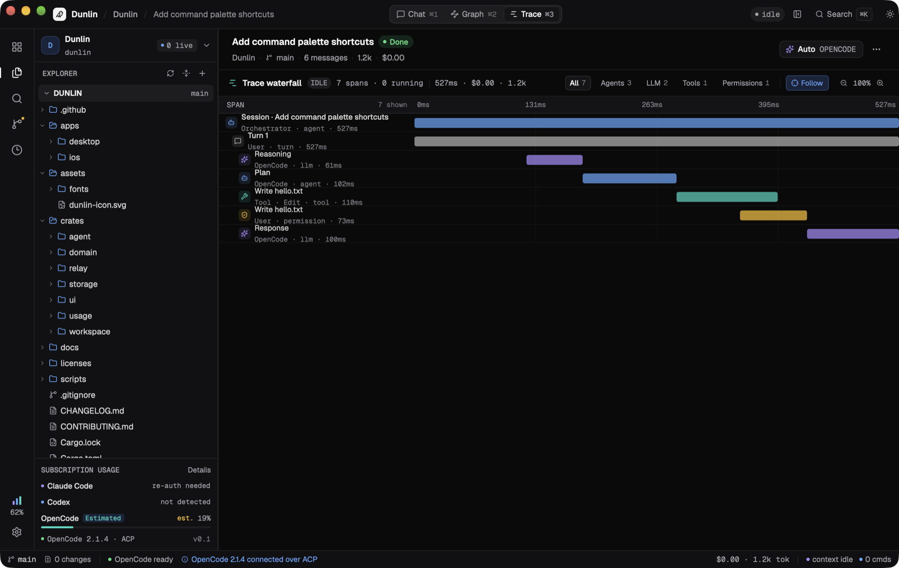

<p align="center">
  
</p>

<h1 align="center">Dunlin</h1>

<p align="center">
  A native, agent-first IDE for macOS.<br/>
  Built in Rust and GPUI. No Electron, no webview, no Monaco.
</p>

<p align="center">
  
  
  
  <a href="https://github.com/corapoid/dunlin/actions/workflows/ci.yml"></a>
</p>

<p align="center">
  
</p>

Dunlin pairs a calm, keyboard-driven workspace with a real
[Agent Client Protocol](https://agentclientprotocol.com) client. One app can
drive OpenCode, Claude Code, Codex or any custom ACP harness, with streaming
messages, plans, tool calls, diffs and permission requests rendered as native
UI instead of a terminal transcript.

The current beta targets **macOS 15+, Apple Silicon, local projects and a
self-hosted relay beta**. The iOS client is a scaffold and is not part of this
release. Source builds are now `0.1.0-beta.2`; see [CHANGELOG.md](CHANGELOG.md).
Website downloads stay pinned to the last published binary release until new
release assets are available.

## Why Dunlin

- **Truly native.** The entire interface is GPUI. The SQLite database is local,
  source control uses the system `git`, and there is no browser runtime in the
  loop.
- **ACP first.** Dunlin speaks the structured Agent Client Protocol directly.
  Tool calls and permission requests become real cards and diffs, not ANSI
  text to parse.
- **Local-first.** Projects, sessions and transcripts stay on your Mac. There
  is no telemetry, no bundled model and no account.
- **Built for follow-ups.** Queue prompts while a turn is running, edit or
  retry a message, copy the agent's answer, and revisit the transcript later.
- **Self-hosted remote.** Pair another Mac or iPhone with your own relay.
  Sessions keep running on the relay, and another device can take over.

## A tour

<table>
  <tr>
    <td width="50%" valign="top">
      
      <br/><sub><b>Open a folder.</b> No demo projects, no hidden workspace. A folder is all Dunlin needs.</sub>
    </td>
    <td width="50%" valign="top">
      
      <br/><sub><b>Make it yours.</b> Theme, harness, permissions, notifications and keyboard hints.</sub>
    </td>
  </tr>
  <tr>
    <td width="50%" valign="top">
      
      <br/><sub><b>See the plan.</b> Plan steps and tool calls become a live agent graph.</sub>
    </td>
    <td width="50%" valign="top">
      
      <br/><sub><b>See the time.</b> Every turn, model call, tool and permission becomes a trace span.</sub>
    </td>
  </tr>
</table>

## Features

### Chat and harnesses

- Streaming assistant output, reasoning, plans, tool calls and usage updates.
- Permission cards with allow-once, always-allow and reject choices.
- Unified diffs previewed inline before or after a tool writes a file.
- Prompt queue with edit, reorder, remove and clear while a turn is running.
- Message actions: copy, retry and edit. Agent responses can be copied as
  Markdown.
- Session history with persisted transcripts and interruption recovery.
- Immediate project/session navigation while ACP context and models load. Local
  agents keep their own runtime while another project is visible (up to eight
  connected adapters; idle adapters can be evicted). Pending follow-ups pause at
  background turn boundaries and resume after foreground send guards pass.
  Relay navigation retains its existing disconnect/cancel lifecycle.
- OpenCode (default), Claude Code, Codex and custom ACP commands. Each project
  can override the harness and permission mode.

### Workspace

- File explorer with a debounced watcher and missing-folder recovery.
- **Settings → Harnesses → Import sessions…** imports OpenCode export JSON,
  Claude Code/Codex JSONL logs or a portable custom-ACP export. Preview project
  assignments, match canonical local paths automatically and assign unmatched
  histories manually. Imports are transactional and insert-only: no source writes,
  prompts or overwriting existing conversations. These are history copies, not
  resumed source sessions or billing scanners. Formats/limits: [session import](docs/session-import.md).
- **Source Control → graph icon** or **Repository → Branch Graph & History…**
  (`⌘⌥G`) opens the local Git DAG with refs and commit details. Select any visible
  commit and create a branch without checkout, changing staging or touching dirty
  files. Load up to 2,000 commits, or enter an older commit/branch/tag to inspect
  its ancestry. No automatic fetch; remote graph and advanced Git actions remain
  on the roadmap.
- **Project settings → Project icon → Choose image…** embeds a bounded PNG/JPEG/
  SVG/ICO as a small normalized PNG; moving the source file does not break it.
  **Automatic** restores repository-icon discovery. The Home heading follows the
  system's local clock/timezone, including while the app remains open. Native
  macOS menus expose Settings, project files, navigation and repository actions,
  with unavailable project actions disabled by context.
- Open multiple local folders at once, or select a collection directory to discover
  its repositories. Canonical roots are deduplicated without overwriting existing
  names, groups, trust, pins or settings; batch imports do not activate every repo.
  Discovery stops at Git/worktree roots, skips generated/hidden directories and
  implicit symlinks, and never fetches or executes repository scripts. Limits:
  8 directory levels, 20,000 entries, 256 projects and 8 seconds; partial imports
  report limits/errors until dismissed. Ordinary non-Git folders remain supported.
  Declared npm/Yarn, pnpm, Cargo and Go workspaces, or multi-package Nx/Turbo/Lerna
  layouts, get a **Monorepo** badge on projects/tiles; packages stay within one root.
- Create files and folders from the Explorer toolbar or a folder's context menu.
  Drag within a project to move; drop files or folders from Finder to copy them
  into a local project while keeping the originals. Existing destinations are
  never overwritten; save a dirty open file before moving it or its folder.
  Imports reject symbolic links and Git metadata and are limited to 1 GiB,
  20,000 entries, 64 nested levels and 1,000 top-level items per drop.
- Syntax-highlighted editor with dirty tracking, `⌘S`, optional autosave,
  external-change detection and conflict recovery.
- Clickable right-hand file minimap with a visible-viewport indicator. Green,
  amber and red mark additions, replacements and deletions against local Git HEAD;
  a separate blue rail marks unsaved edits and clears on save/Undo. Remote files
  show unsaved edits only. Settings → Editor → File minimap hides the map.
  Overview/diff work runs off-thread with bounded drawing and comparison budgets.
- Independent file tabs and a Chat tab retain buffers, undo and scroll positions
  during this launch. `⌘⇧S` saves all tabs; quit protection covers every dirty tab.
  **Close all** closes the current project's file tabs without stopping Chat;
  dirty buffers offer Save All, Discard or Cancel.
- Bounded PNG/JPG/SVG previews and paged native PDF rendering. Other binary and
  unsupported extensions (including ZIP, AVIF and MP4) are rejected with a toast.
  SVG scripts, external images, DTDs and compressed SVG are not executed/loaded.
  Images and PDF pages fit entirely inside the current preview viewport, including
  after resizing the window or sidebar.
  Preview bitmaps go directly to the renderer without a PNG encode/decode round
  trip. PDF rendering handles page rotation/crop origins and keeps a bounded LRU
  cache of rendered pages; SVG system fonts are loaded once and only when needed.
- Explorer rename, delete and Reveal in Finder. Local deletion uses system Trash
  with confirmation; remote deletion only removes files or empty folders. Dirty
  and loading tabs protect mutations; renames never replace existing items.
- Project search that skips build, VCS and secret files.
- Source control backed by the system `git`: status, stage, unstage, discard,
  commit, amend, pull, push, branches and read-only diffs.
  Non-repository folders show a normal empty state with an explicit Initialize
  repository action; no automatic initialization, staging or commits.
  Clicking a change opens its staged or unstaged diff (including new files),
  loaded off the UI thread instead of opening the editor.
- Click the branch badge on a Dashboard tile, in Source Control or on the status
  bar to search local branches (`↑↓`, Enter, Esc). The command palette also has
  **Switch branch…**. The picker loads repository state asynchronously and does
  not start agents or change project/session selection on Dashboard.
  The full picker has a fixed height during loading, filtering and errors, with
  a scrollable branch list. The bottom status-bar branch badge opens a small
  searchable list immediately above the badge, using the same backdrop as dialogs;
  click outside or press Esc to close it. Both use the same safe checkout flow.
  Unsaved project buffers offer **Save all and continue** / Cancel, never Discard.
  Git changes require separate **Keep changes and switch** consent with staged,
  unstaged and untracked counts. Native Git refuses overlapping edits, untracked
  collisions, ignored-file overwrites and branches held by another worktree.
  No automatic stash/pop, reset, forced checkout, merge, commit or branch creation.
  A changed preflight, unresolved Git operation, dirty/loading buffer, active
  project/group agent or competing Dunlin mutation stops the operation. In-flight
  switches retain their lock even if the picker closes, and prevent quitting until
  Git completes. External editors/Git clients and repository hooks are not sandboxed.
- Agent graph and trace waterfall projected from the live transcript.
- Nested logical project groups, pinned ordering and per-project settings.
  Switch **List / Tree** and sort by **Name ↑ / Modified ↓** in Projects; modification
  sorting uses cached Git/worktree timestamps rather than a recursive file scan.
  List mode retains assignments and shows full group paths. Right-click the
  **Projects** heading or its list for **New group… / Open local folders…**;
  right-click a group for **New subgroup…**, rename/delete and **Move group to…**.
  Drag group headers to reparent them; cycles are rejected. Deleting a group
  promotes direct projects and subgroups one level. Undo restores eligible members
  without overwriting subsequent moves, touching files or changing conversations.
  Existing groups migrate to top level without resetting histories/settings.
- Resize the sidebar by dragging its right edge (220–560 points, clamped to the
  window); release to save its width, or double-click the edge to reset to 278.
- Drag project rows onto group headers (organization only; no disk moves).
  Whole group sections now accept drops, with destination labels, strong outlines
  and a readable floating project card while dragging. Each group has an explicit
  neutral agent icon next to Edit, with a scope explanation and a project count
  in the group heading. New conversations include descendant groups' projects.
  The group's agent action creates a conversation with a frozen manifest of
  1–32 trusted local project roots, attached to every request without reading
  their files or automatically sending a prompt. The strictest member approval
  policy applies. This is explicit agent context, not a filesystem sandbox;
  it does not widen remote grants or include future group members.
- Dashboard is the first sidebar destination, with live working/waiting/connecting
  agents, seven-day totals and a configurable 144-day dot activity map using the
  application palette. On Dashboard, the top titlebar switches activity metrics
  rather than conversation views. A centered, width-limited content column keeps
  tiles, metrics, dots and captions balanced; short dashboards center vertically,
  while taller content remains scrollable.
  Activity totals/captions are centered as one column. Light mode uses muted dots
  without glow and visible recent-project tile borders; data caveats stay in the
  Dashboard's bottom footer, outside its content scroller.
  When no sessions are active, up to three recently
  used projects appear as clickable tiles, based on persisted user visits and
  recorded user requests (not background agent output).
  **Open project** sits in its own footer at the bottom of each recent-project tile.
  Tiles show the branch's last **committer** date and upstream status. Only visible
  recent trusted local projects automatically run a read-only, timeout-bounded
  `git ls-remote` check (two-minute cache; refresh icon for an explicit recheck).
  Fresh observations carry a check time; cached local tracking counts are labelled
  separately. Missing upstreams, deleted branches and failed checks stay distinct.
  Known objects allow exact ahead/behind counts; an unknown advertised commit says
  **fetch needed to compare**, never an invented behind count. No automatic fetch,
  pull, merge, tracking-ref update or authentication dialog is requested. Relay
  workspaces currently show an unavailable/local-check state rather than probing
  the relay or borrowing another repository's status.
  Recent tiles, the project list and switcher share one project icon. Trusted
  local projects automatically use literal HTML favicon links, web-manifest
  icons, Next.js file-based icons or conventional favicon/logo assets (SVG,
  PNG, JPEG and ICO). Detection runs off-thread, refreshes periodically and on
  active-project file changes, and falls back to the existing colored monogram.
  It never fetches external URLs, executes repository config, invokes AI or
  creates `AGENTS.md`; remote/untrusted projects retain their monograms.
- Chat opens without the redundant session-information band. Session actions and
  the reasoning toggle remain in the titlebar; transcripts are unchanged.
  The Sessions sidebar and its count hide unstarted drafts, including adapter-only
  failures, until a user message is recorded. Drafts are not deleted; existing
  histories remain available when transcript reads fail or remote data is loading.
  Metrics use recorded requests, reported token deltas and tool-reported diffs
  only, not context occupancy or inferred Git history. Missing data stays unknown.
  Settings → General chooses visible widgets and Dashboard/last-project startup.
- Collapsible Account usage and an animated sidebar. Settings and branch panels
  use localized native **Liquid Glass** on macOS 26+, or AppKit's translucent
  Popover material on macOS 15+. A transparent, owner-attached render plane puts
  glass below the panel's sharp text/controls and above the application scene.
  Rounded glass follows measured panel bounds, including borders and resizing;
  panels have a 14% tint with a subtle border/shadow. Branch layouts remain
  530 × 460 and 300 × 170 points.
  The main window gets only 12% dimming and a weak HeaderView material at 14%
  alpha, never full-window Liquid Glass. Menus remain sharp; nested application
  dialogs do not accumulate dim layers. Native confirmations/file pickers track
  their lifetime with shared leases and clean up on completion/cancellation.
  Native materials do not intercept input, capture the screen, write files or
  override macOS Reduce Transparency preferences. Glass is runtime-gated to keep
  macOS 15 compatibility; a failed panel window falls back to in-window rendering.
  Trace separates idle/unrecorded gaps and compresses them on the
  active-time axis rather than extending the preceding response.
- Settings is larger and fits the window (up to 1120 × 760 points), with rounded
  panel-local glass and inset child backgrounds to prevent light-theme corner
  artifacts. **Design → Application / Sidebar / Agent / Editor** groups appearance
  controls. **Design → Sidebar → Show branch names** hides project-list branch
  labels independently of Git changes and branch controls elsewhere.

### Skills and AI commits

**Settings → Skills** maintains one persisted instruction library for all projects.
Add, edit or delete skills, then explicitly install/update their global copies with
the OpenCode, Claude Code or Codex buttons. **Other folder…** exports to a custom
harness's global skills directory. These buttons do not install harness programs,
sign in, change their settings or send AI requests. Review instructions first:
agents may execute the tools they describe.

| Harness | Default global skills directory |
| --- | --- |
| OpenCode | `$XDG_CONFIG_HOME/opencode/skills` or `~/.config/opencode/skills` |
| Claude Code | `$CLAUDE_CONFIG_DIR/skills` or `~/.claude/skills` |
| Codex | `~/.agents/skills` |

Exports contain instructions only, at `dunlin-<id>/SKILL.md`; scripts, references
and other supporting files are not imported or synchronized. Library edits do not
silently update installed copies. Updates/removals require the recorded contents
to remain unchanged: unmanaged files, external edits and symlinked skill files or
directories are preserved. Removing a skill never recursively deletes supporting
files. Project-level definitions may override global skills; a running harness
may need a new session to discover an installation.

When local AI authentication and the last used model can be verified, Source
Control shows **Commit on AI** instead of the commit-message field. It uses the
exact harness, model and OpenCode provider/filter recorded at the last dispatched
request, not merely the current picker selection. Missing model metadata or an
unavailable target never selects another provider/model. Otherwise the original
manual commit form remains available, also via **Manual commit**.

The action asks for confirmation that it may consume paid tokens and create
commits, then opens a separate conversation using the bundled, editable
**Conventional commits** skill. The skill reviews repository policy and recent
history, groups coherent changes into as many Conventional Commits as warranted,
preserves partial staging and staged scope, and forbids pushes, history rewriting,
secret commits and hook bypasses. Its library instructions are injected directly;
using the action does not automatically install global files.

AI commit preparation requires a trusted local repository root, saved buffers,
no conflicting Dunlin agents/file or Git operations, no unresolved Git operation
and nonempty changes. Navigation or cancellation invalidates preparation. While
the agent runs, Dunlin blocks competing mutations and other agents in that
project. Normal approval gates remain in effect: this is not a filesystem sandbox
and does not lock out external Git clients or editors. Authentication checks use
metadata/status only, never a test prompt. Remote projects and custom ACP auth
contracts currently retain manual commits. Histories/settings are preserved;
pending AI commit requests are not resumed after restarting Dunlin.

### Remote relay

- Self-hosted `dunlin-relay` with accounts, devices and project grants.
- One-time pairing codes; device tokens live in the macOS Keychain.
- ACP over WebSocket with session leases and explicit takeover.
- Transcript snapshots so another device can show history.
- Explorer file/folder creation, internal moves and Git initialization require
  an updated relay (`/v1/fs/mkdir`, `/v1/fs/move`, `/v1/git/init`). Finder imports
  are local-only; remote Explorer does not upload dropped Mac files.
- Preview, rename and non-recursive delete also require the updated relay
  (`/v1/fs/preview`, `/v1/fs/rename`, `/v1/fs/delete`) and the same project grant.
- Safe branch switching requires the updated relay's `/v1/git/branch-context`
  and `/v1/git/switch-safe` endpoints and the existing project grant. Older relays
  show an update error; Dunlin never silently falls back to legacy checkout.
- macOS seatbelt sandbox for the harness, denying other projects and common
  credential stores.

## Install

### Download the beta

The current beta is ad-hoc signed because there is no Apple Developer ID yet.
macOS Gatekeeper may ask you to approve the app in
**System Settings → Privacy & Security**.

Release artifacts are published on the
[releases page](https://github.com/corapoid/dunlin/releases):

- `Dunlin-<version>-macos-arm64.dmg`
- `Dunlin-<version>-macos-arm64.zip`
- `dunlin-relay-<version>-macos-arm64.tar.gz`
- `SHA256SUMS`

The app requires macOS 15 or newer on Apple Silicon. Intel Macs are not
supported in 0.1.

### Build from source

Requirements:

- macOS 15 or newer on Apple Silicon
- Rust 1.92 or newer (`rustup` recommended)
- `git` on `PATH`
- An ACP harness for real agent work, for example `opencode acp`

```sh
git clone https://github.com/corapoid/dunlin.git
cd dunlin
cargo run -p dunlin
```

The first launch creates `~/Library/Application Support/Dunlin/dunlin.db` and
shows onboarding. Set `DUNLIN_DATA_DIR` to use a different data directory.

To build a local app bundle:

```sh
./scripts/bundle-macos.sh --build
open dist/Dunlin.app
```

The bundling script also checks standard Rust/rustup installation directories
if Cargo is missing from `PATH`, including Homebrew's keg-only rustup on macOS.

The script renders `assets/dunlin-icon.svg`, writes `Info.plist`, copies the
license notices into the bundle and applies an ad-hoc signature. To sign with a
Developer ID:

```sh
DUNLIN_CODESIGN_IDENTITY="Developer ID Application: Your Name (TEAMID)" \
  ./scripts/bundle-macos.sh --build
```

## Harnesses

Open **Settings → Harnesses** (`⌘,`) to choose the default harness and edit the
custom ACP command. Dunlin checks whether each command is installed and
connects when a project opens.

| Harness | Command |
| --- | --- |
| OpenCode | `opencode acp` |
| Claude Code | `claude-agent-acp` |
| OpenAI Codex | `codex-acp` |
| Custom ACP | Any command that speaks ACP over stdio |

The default is OpenCode. Permission modes are **Ask every time**, **Read-only**
and **Auto-approve**. ACP permissions are never auto-approved by the relay.

Click the model dropdown in the composer to choose a model advertised by the
connected harness. Model changes are confirmed by the harness; not every ACP
agent exposes selectable models. Local conversations resume their ACP session
when the harness supports loading sessions. If resuming fails, the saved history
is kept and Dunlin asks you to start a new session instead of silently resetting
the agent's context.

New conversations are remembered even when the Chat tab is already selected.
On startup, an unused conversation containing only connection failures from a
missing harness can recover to the newest existing conversation for the
available project/default harness. Conversations with user/agent content or an
ACP session ID are never skipped or migrated this way. Missing local ACP commands
show setup actions instead of repeated spawn errors; signing into a harness's
own CLI does not install its separate ACP adapter. Startup failures are not
automatically retried. Consecutive historical errors are grouped visually without
deleting their saved entries.

The chat composer has inline dropdowns for **environment**, **harness**,
**agent mode / tool permissions** and **model**. New conversations start with a
centered composer. **Enter** sends a message; **Shift+Enter** inserts a new line
(`⌘Enter` also sends). Agent modes (for example Plan or Build) come from the harness,
not from hard-coded prompts; unsupported modes are not offered. Changing the
local harness starts a new conversation and preserves the old one. Environments
are this Mac and paired relays; choosing another environment opens a project
there rather than relocating a running conversation. A repository-context picker
for project-independent chat is planned under Standalone chat in the roadmap.

### OpenCode accounts, Free and Go

**OpenCode** remains the ACP harness; **OpenCode Go** (`opencode-go`) is a
provider inside it, separate from regular `opencode` billing. For local OpenCode
conversations, select the provider in the composer (Go is the initial filter).
The provider picker beside the OpenCode harness shows **Sign in…** only while
the selected provider has no available account connection. It disappears after
successful sign-in, including across restarts; **Add / reconnect account…** stays
in the provider menu. Public OpenCode connection metadata is the source of truth,
not a persisted Dunlin authentication flag. These controls are not shown for Claude Code,
Codex or other ACP harnesses: their own clients manage account authentication.
The model picker only offers that provider's enabled models also advertised by
ACP. Its first section contains up to three recently used models, with no
duplicates, scoped to that provider, harness and environment and saved across
launches. Models no longer available are omitted, including from recents.

**OpenCode Free** is an explicit UI filter, not an additional provider or plan
identifier sent to OpenCode. It offers only enabled `opencode` models advertised
by ACP whose discovered input, output and cache prices are all zero in every
pricing tier. Unknown/missing prices and Go-only promotions are excluded. The
original `opencode/model` IDs are preserved; recents and sending use the same
allowlist. An empty or failed catalog never substitutes a paid model. Free model
availability, limits and privacy policies remain controlled by OpenCode.

Use **Connect provider account…** in the provider menu, or
**Settings → Harnesses → OpenCode provider accounts**. This opens the official
provider sign-in dialog inside Dunlin, with the methods advertised by OpenCode.
The dialog resolves the provider's current `integrationID` even if discovery has
not finished. When OpenCode maps Go to its Console integration, browser account
sign-in is preferred and completion is detected automatically; Free uses the
regular OpenCode account integration. API keys remain available for integrations
that advertise them, including genuinely key-only Go setups. Required
provider-specific forms without defaults are not silently bypassed.

Keys and authorization codes are held only for submission, sent in authenticated
HTTP bodies to the verified local OpenCode service and persisted by OpenCode,
not Dunlin. They never enter subprocess arguments, temporary scripts, logs or
chat history. Redirects and environment proxies are disabled for authentication.
Models and the existing ACP session refresh automatically after connection,
without discarding conversation context. **Refresh providers / models** remains
available for changes made outside Dunlin. Remote OpenCode HTTP services are not
supported by this local sign-in dialog.
Empty startup catalogs are retried a bounded number of times and checked again
after ACP session initialization; persistent discovery failures are shown with
an explicit refresh action rather than silently appearing as a Go-only catalog.

Switching the provider filter does not silently change a session's model:
choose one explicitly before sending. Dunlin blocks sending through a model
from a different provider and keeps the composer text. Account connection counts
and advertised models do **not** confirm balance or subscription entitlement.
On remote projects, authentication and provider configuration belong on the
relay; Dunlin never uses this Mac's account catalog for those conversations.

Chat keeps each kind of information in one place: the conversation header owns
its title, status, project, branch and message count; the composer owns environment,
harness, provider, mode and model selection; the status bar owns connection state,
cost and context usage. Assistant message headers show the speaker rather than
repeating the current global model/harness for every historical response. Model
labels omit the selected provider's prefix without changing model IDs. Reasoning
can be toggled from the conversation header; starter suggestions only appear for
an empty chat. Detailed diagnostics remain in settings, Graph and Trace.

The sidebar's **Account usage** panel follows the active environment, harness
and (for OpenCode) provider filter. It never mixes Claude Code, Codex and OpenCode
accounts, or uses the local Mac's accounts for remote projects. Only the selected
local harness is probed. Codex uses its app-server; supported OpenCode services
provide Go allowance windows or applicable Console budgets via the location-scoped
usage-limits API. Free does not inherit paid-plan allowances. Unsupported services
or providers show **Limits unavailable**, without estimated percentages. ACP
context usage stays separate in the status bar and session details. The activity
rail uses the same active account data instead of a fixed percentage. Usage
refreshes on selection changes, connection, sign-in, completed turns and manual
refresh; late responses from a previous selection cannot replace the active data.
The Go/Console limits endpoint requires a running OpenCode service at **2.2+**.
Updating the CLI does not update an already running service: finish active turns,
then run `opencode service restart` and refresh usage. Older services show this
requirement explicitly; the panel also links to Console for checking usage there.

Chat opens conversations at the latest message and follows streaming replies
while the reader stays near the bottom. Scrolling up pauses following; **Jump to
latest** resumes it. Sending a message also returns to the live edge. Message
content keeps its natural height instead of being compressed behind the composer.

Model menu entries are single-line display names without decorative stars or
wire IDs. The composer keeps **Attach** and replaces Mention / Tools with an
**MCP** menu. For local OpenCode, its count is connected servers not excluded by
this session; agent/provider policies can impose additional restrictions. The
menu shows server status and lets an idle conversation exclude a server using
session permissions. This takes effect on the next turn without restarting the
session, disconnecting a shared server, or changing project/global MCP config.
Excluded tool definitions and server guidance are omitted by OpenCode; earlier
tool output and instructions already in the conversation are not erased. Dunlin
only removes exclusions it created and never relaxes existing user policies.
Ambiguous normalized server names are read-only to avoid affecting another
server. Other harnesses/relays show an unknown count rather than this Mac's MCPs.

Enable **Settings → Chat → Final answer only** to hide reasoning, plans, tools,
subagent output and intermediate assistant text in Chat. **Stream responses**
is independently configurable and enabled by default, including in final-only
mode: the current root reply appears as chunks arrive. Turn it off to wait for
completion. A harness that sends text only at completion cannot be made to
stream by the UI; no artificial typing delay is added. Permission gates and
errors remain visible.
The setting persists across launches and does not remove recorded history.
Graph defaults to agents and actual delegated sessions only. Click an agent to
show/hide its tools; plans and tool calls never masquerade as agents. **Save SVG**
exports the currently disclosed tree through a native save dialog, including
offscreen nodes. Trace defaults to user requests, with per-request disclosure,
**Requests** to collapse details, and **Expand all**. Kind filters retain parent
requests so matching events remain navigable. Follow/zoom controls are removed.
Tool nodes are grouped under their owning subagent when origin metadata is available. OpenCode's child-session metadata
and message IDs are retained so interleaved child/reasoning chunks do not split
or pollute the root reply. Assistant answers render as Markdown, including
headings, emphasis, tables, lists, links and fenced code; links open only on click
and only for HTTP(S) or mailto URLs. Copying an answer preserves its Markdown.

New conversations start **Ready**, not Waiting. Graph and Trace show an empty
state until the conversation has actual events; they never substitute demo
agents, tools, costs or timings. Waiting is reserved for permission requests.

**Settings → Editor** has installed-font pickers for the interface and code.
Selections persist, apply immediately and survive light/dark theme changes.
The read-only preview uses the same editor as project files, reflecting code
font, size and word wrap without editing or autosaving a real file. Geist and
Geist Mono remain the bundled defaults/fallbacks; fonts are not downloaded.
Explorer and search results use colored, type-specific file icons, including
web source, config, package manifests, lockfiles, media, databases and archives.

**Settings → Chat** groups message times (local timezone), elapsed agent-turn
duration in parentheses, response logo, reasoning and final-answer-only options.
The streaming preference is saved here too. Trace has a separate token column:
ACP context-window occupancy is never shown as consumed tokens. If a harness
provides the optional cumulative end-turn usage extension, Dunlin records the
snapshot and attributes only verified counter differences to requests. A new
session has a known zero baseline; after resuming, the baseline is unknown until
a fresh snapshot arrives. Unreported per-model/per-tool consumption and legacy
usage remain **—**, not zero or an estimate.
Times/duration are optional; unknown legacy timestamps and durations are not
invented. Newly recorded turn duration starts when the prompt is dispatched and
ends at completion/cancellation/error, including tools and approval waits.

Account limits are cached per environment/harness/provider (and model only for
Console budgets). Switching Go sessions does not clear account limits while ACP
reloads model metadata. The sidebar footer keeps a fixed height; transient
request errors retain labeled cached limits, never data from another scope.
Successful reauthorization clears the cache. Trace rows reserve room for both
label lines and padding at every zoom level.

Harness settings automatically detect supported CLIs and ACP adapters on PATH
and in common Homebrew/user installation directories, with a **Scan again**
action. A CLI without its ACP adapter is labeled separately and links to setup
instructions. No discovery command runs an agent, installs software, signs in or
changes the active conversation. Choose an installed adapter as the default for
new conversations; remote harnesses remain configured on the relay.

To remove a configured project, use **… → Remove project…** beside its entry in
the Projects sidebar, or right-click the project. This removes its local session
history from Dunlin, **not the folder or files on disk**. Removing a remote
project does not delete it from the relay. You can remove the last project too.

## Remote relay

`dunlin-relay` is a small self-hosted server. It stores accounts, devices,
project grants, a session index and, by default, transcript snapshots. OpenCode
remains the source of truth for live sessions; the relay's snapshot lets another
device show history and provides a backup.

Build and initialise it on the machine that has the repositories:

```sh
cargo build -p dunlin-relay
./target/debug/dunlin-relay init
./target/debug/dunlin-relay user add marek
./target/debug/dunlin-relay project add dunlin /Users/me/git/dunlin --user marek
./target/debug/dunlin-relay pair marek --ttl 10
./target/debug/dunlin-relay serve
```

Optional `~/.config/dunlin/relay.toml`:

```toml
listen = "127.0.0.1:8787"
harness = "opencode acp"
linger_secs = 900       # keep an in-flight turn alive after the client leaves
sandbox = true          # macOS seatbelt: deny other projects and credentials
store_transcripts = true
```

`serve --config ~/.config/dunlin/relay.toml` uses it. CLI flags and
`DUNLIN_RELAY_*` environment variables override the file.

`serve` listens on `127.0.0.1:8787` by default. For a phone or another Mac,
expose it over Tailscale:

```sh
tailscale serve --bg --https=443 http://127.0.0.1:8787
```

Then enter `https://<machine>.<tailnet>.ts.net` and the one-time pairing code in
**Settings → Remote** on macOS, or in the iOS app. A paired device receives its
own token; revoke it with `dunlin-relay revoke <device-id>`.

Remote projects support the full macOS surface: explorer, editor with save,
search, source control, diffs, chat, permissions, graph and trace. A session can
be opened on one device at a time; if another device is active, use **Take over
session** in the session menu or the **Take over** button on iOS. Composer
attachments are uploaded to `.dunlin/attachments` on the relay and kept out of
`git status` through `.git/info/exclude`.

If the client disconnects while a turn is running, the relay keeps the harness
alive for `linger_secs` (15 minutes by default) so the turn can finish and the
result is persisted. Permission requests raised during that window are
auto-cancelled. Set `linger_secs` or `DUNLIN_RELAY_LINGER_SECS` to change the
window.

Users are isolated: each account sees only granted projects and its own
sessions. All relay users currently share the OpenCode credentials installed on
the server. The macOS relay runs each harness under a seatbelt profile that
denies other project roots and common credential stores (`.ssh`, `.gnupg`,
`.aws`, browser profiles, Documents/Desktop/Downloads). This is a best-effort
privacy boundary, not a container; use separate OS accounts or containers for
hard isolation.

The relay database is not encrypted at rest. Set `store_transcripts = false` to
keep only metadata, and use FileVault or an encrypted volume on the relay host.

## How Dunlin compares with Orca

[Orca](https://github.com/stablyai/orca) is an excellent, much more mature
AI orchestrator and the closest point of reference for this project. It is also
MIT-licensed. The comparison below is about fit, not quality.

| | **Dunlin 0.1 beta** | **Orca** |
| --- | --- | --- |
| Foundation | Rust + GPUI; no browser runtime | Electron + Chromium |
| Agent integration | Structured ACP client | CLI agents in terminal sessions |
| Parallel worktrees | Planned | Yes, a core feature |
| Terminal | Planned | Ghostty-class terminal with splits |
| Git | Status, commit, push, branches, diffs | Worktrees, PRs, Linear, diff annotation |
| Agent graph and trace | Live projections of the transcript | Session and task views |
| Remote | Self-hosted relay with session takeover | SSH worktrees, mobile companion |
| Mobile | iOS scaffold; not in 0.1 | Shipped iOS and Android apps |
| Platforms | macOS 15+, Apple Silicon | macOS, Windows, Linux |
| Maturity | Early public beta | Mature, shipping daily |
| License | MIT | MIT |

**Choose Orca** if you want terminal-native agents, parallel worktrees, a mature
mobile companion, SSH hosts or Windows/Linux support today.

**Dunlin may fit** if you want a native ACP client that treats tool calls and
permissions as structured UI, a small local-first workspace, and a self-hosted
relay you can run yourself.

If Dunlin is missing something you need, open an issue. The roadmap is public
and intentionally honest about what is not built yet.

## What is not in 0.1

- iOS build and sync (the SwiftUI client is a scaffold).
- Terminal and shell integration.
- Computer use.
- Automations, skills and artifacts.
- Visual Markdown editor.
- Parallel worktrees and multi-agent orchestration.
- Universal or Intel builds.

See [`docs/ROADMAP.md`](docs/ROADMAP.md) for the release gate and the next
milestones, and [`docs/PLAN.md`](docs/PLAN.md) for the architecture.

## Development

```sh
cargo fmt --all --check
cargo clippy --workspace --all-targets
cargo test --workspace
./scripts/relay-smoke.sh
```

Optional installed-OpenCode checks run serially because they share its live
location/catalog initialization: `cargo test -p dunlin -- --ignored --test-threads=1`.
They do not send prompts or connect/disconnect MCP servers; the MCP isolation
check creates, modifies and deletes one idle scratch session, leaving existing
conversations and configured servers unchanged. `DUNLIN_MOCK_RICH_CHAT=1` enables
a deterministic Markdown/child-stream fixture in `mock_acp_agent`, without
network calls or file tools.

On macOS, `cargo run -p dunlin-ui --example typography_smoke` checks native font
discovery, size metrics and font preservation across theme switches. It opens
no project or conversation and makes no network requests.

The marketing site lives in [`web/`](web). It is a static Astro build with
React islands, Tailwind CSS and self-hosted fonts:

```sh
cd web
npm install
npm run dev
```

See [`web/README.md`](web/README.md) for the design notes, social card and
deployment instructions.

The agent crate includes deterministic smoke tools:

```sh
# End-to-end ACP turn against a real harness
cargo run -p dunlin-agent --bin harness_smoke -- "opencode acp" "Reply with: HARNESS OK"

# Permission round-trip against the bundled mock agent
cargo build -p dunlin-agent --bins
./target/debug/permission_smoke allow
./target/debug/permission_smoke reject

# Relay end-to-end: pairing, ACP-over-WS, session isolation and grants
./scripts/relay-smoke.sh
```

Useful diagnostics:

- `DUNLIN_TRACE_HARNESS=1` logs every harness event to stderr.
- `DUNLIN_HARNESS_COMMAND="..."` overrides the configured harness command for one run.
- `DUNLIN_DATA_DIR=/path` redirects the SQLite database.
- `DUNLIN_LOG_FILE=/path` redirects the lifecycle log (default `~/Library/Logs/Dunlin/dunlin.log`).
- `DUNLIN_CODEX_BIN=/path/to/codex` overrides Codex detection for live usage probes.
- `DUNLIN_AUTOPROMPT="..."` sends a prompt once the harness connects.
- `DUNLIN_RELAY_DB=/path` and `DUNLIN_RELAY_LISTEN=addr` configure the relay.
- `DUNLIN_RELAY_HARNESS="opencode acp"` sets the command the relay spawns.
- `DUNLIN_RELAY_LINGER_SECS=900` keeps an in-flight turn alive after disconnect.
- `DUNLIN_RELAY_SANDBOX=0` disables the macOS seatbelt profile.
- `DUNLIN_RELAY_STORE_TRANSCRIPTS=0` keeps only relay metadata.
- `DUNLIN_RELAY_DEBUG=1` prints the sandbox profile and forwards harness stderr.
- `DUNLIN_REMOTE_TOKEN=...` is a test-only fallback for the macOS remote token.

## Architecture

```
apps/desktop        GPUI application, views, git, search and local state
apps/ios            SwiftUI remote client (Xcode project generated from project.yml)
web                 Astro marketing site (static build, React islands)
crates/ui           Design system on top of GPUI Kit
crates/domain       Shared project, session, usage, graph and trace types
crates/workspace    Tree, search, git and filesystem operations
crates/agent        Reusable ACP client on a dedicated worker thread
crates/relay        Self-hosted relay: accounts, pairing, grants, ACP-over-WS
crates/storage      SQLite persistence (WAL, foreign keys, migrations)
```

The ACP worker owns all protocol I/O. The UI sends commands and receives events
over channels, so a slow model or child process never blocks the render thread.
Permission handlers respond from a spawned task to keep the ACP dispatch loop
moving.

Data lives in SQLite with WAL enabled. Projects and sessions are upserted as
they change; transcripts are saved when a turn finishes, when a permission is
resolved, when switching sessions and on shutdown. Settings are stored as JSON
in the same database, so new options can be added without a schema migration.

## Security

Please report vulnerabilities privately as described in
[`SECURITY.md`](SECURITY.md). Do not open a public issue for a security problem.

## Contributing

See [`CONTRIBUTING.md`](CONTRIBUTING.md). The project is early; small, focused
pull requests are easiest to review.

## License

Dunlin is released under the [MIT License](LICENSE). Bundled fonts and
dependencies are listed in [`THIRD_PARTY_NOTICES.md`](THIRD_PARTY_NOTICES.md).
