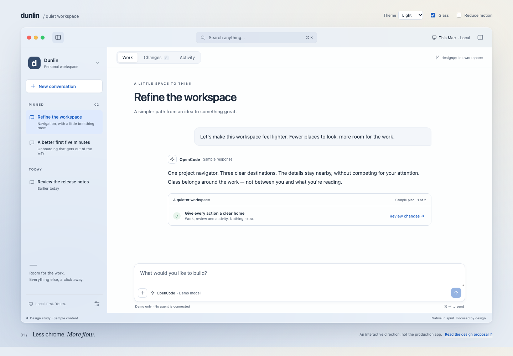
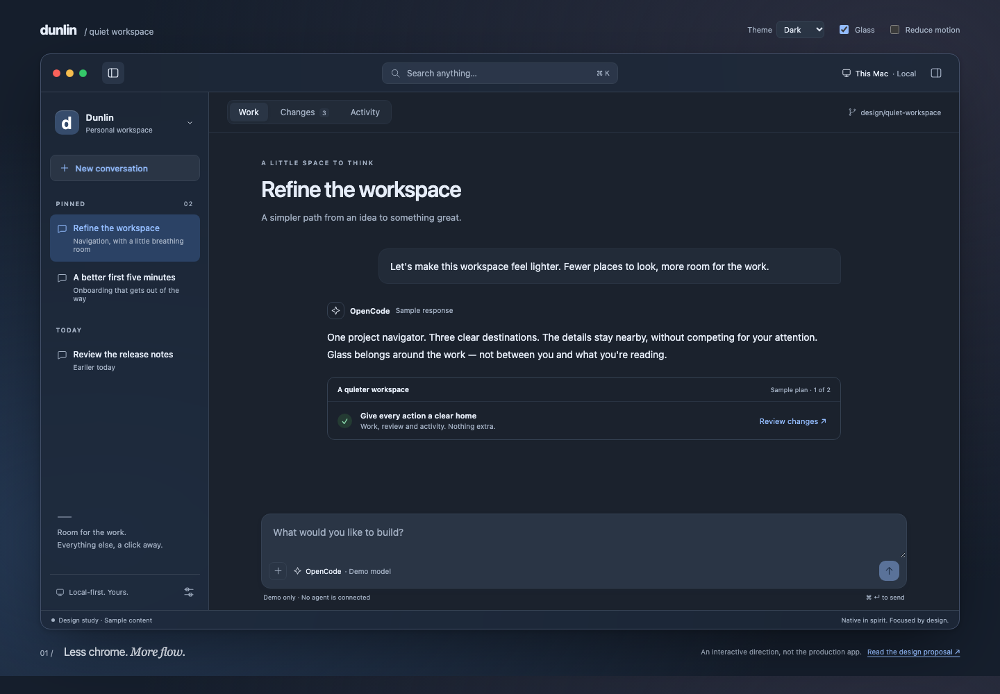

# Quiet Workspace — UI direction

**Design proposal, not a shipped interface.** Prepared 2026-11-09. The native
application is unchanged by this proposal. This is a task-first information
architecture, not a rearrangement or critique of the existing menus.

## Try the concept

Open the [interactive prototype](ui-concepts/quiet-workspace.html) locally:

```sh
open docs/development/ui-concepts/quiet-workspace.html
```

No build, dependencies, network requests, telemetry, agent calls or repository
operations. All conversations, changes and activity are **sample data**. The
browser approximates the composition and motion; CSS blur is not native Apple
glass, and this is not a proposal to embed a browser in Dunlin.

Try Work / Changes / Activity, switching projects and conversations, the context
inspector, file review, a new conversation, the command palette, theme, glass and
Reduce Motion. `⌘K` / `Ctrl+K` opens commands; Escape closes dialogs. Reload resets
everything. Project switching keeps separate demo conversation drafts.

Optional browser smoke checks use an externally installed Playwright (not a
runtime or application dependency): `node scripts/ui-concept-smoke.mjs`, also
with `--webkit`. If it is installed outside the repository, set
`PLAYWRIGHT_MODULE` to its absolute `index.mjs` path. Optional
`PLAYWRIGHT_EXECUTABLE_PATH` selects an existing browser executable, and
`DUNLIN_UI_CONCEPT_EVIDENCE` names a directory for light/dark browser captures.

### Light and dark previews

Browser captures of the design study, not screenshots of the native application:





## The idea

**One project. One place to work. Details when needed.**

The workspace should feel like a thoughtful Mac document application, not an
administration console. A quiet, translucent navigation layer surrounds an opaque
reading surface. Blue identifies the next action, not every interactive element.
Depth communicates hierarchy; motion explains a change of state.

### Organize around three jobs

| Job | Place | What belongs here |
| --- | --- | --- |
| Build with an agent | **Work** | Conversations, document/editor tabs, approvals, composer; optional terminal dock |
| Understand and accept changes | **Changes** | Diff review, staging, commit draft, history, branches and worktrees |
| Understand what happened | **Activity** | Real run events, requests and tools, with Graph / Trace as detail lenses |

These are peer destinations within a project, not three apps or three copies of
the same session. Returning to Work restores its document, scroll position and
draft. Activity may show a real pending approval badge; it never invents progress.

### Window anatomy

```text
┌ traffic lights · sidebar     Search / commands            host · inspector ┐
│ Project ▾             │ Work · Changes · Activity                          │
│ New conversation      ├──────────────────────────────┬─────────────────────┤
│                       │                              │ Context (optional)  │
│ Pinned conversations  │ Current conversation /       │ Files · Plan        │
│ Recent conversations  │ document / review            │                     │
│                       │                              │ Scope, agent, model │
│                       │                              │ Attached resources  │
│                       │                              │                     │
│ Settings              │ Composer / task actions       │                     │
└───────────────────────┴──────────────────────────────┴─────────────────────┘
```

- **Project navigator, 232–272 pt:** a project switcher, an explicit New
  conversation action, pinned/recent conversations and search. No permanent
  catalog of every feature. The project switcher offers collections, local and
  remote projects, and explicit add/import actions. Selecting a project never
  silently installs, clones or changes a running session's environment.
- **Unified toolbar, 52–56 pt:** genuine macOS traffic lights and window dragging;
  sidebar toggle, command/search entry, selected host and inspector toggle.
  Project and host remain distinguishable. A remote hostname is always visible
  before sending a prompt, approving a tool or mutating Git.
- **Main surface:** conversation/document content gets the width. Start with one
  document pane; split deliberately, preserving Dunlin's existing two-pane work.
  No metrics dashboard between opening a project and doing work.
- **Context inspector, 280–320 pt, closed by default:** Context / Files / Plan.
  Scope, agent and model; attached resources; workspace files and plan details.
  Inline links reveal the relevant inspector tab rather than opening another
  permanent navigation rail. Status is still understandable when it is closed.
- **Terminal:** an opt-in bottom dock with its own tabs/splits, not a fourth
  primary destination. Errors can link directly to the relevant output.

## Navigation and menus

Keep the **system menu bar** native. It is the complete, searchable keyboard
command surface, not a duplicate sidebar. Proposed groups:

| Menu | Responsibility |
| --- | --- |
| Dunlin | About, Settings (`⌘,`), Services, Hide, Quit |
| File | Open/add project, new conversation/document, save, close |
| Edit | Undo/redo, text editing, Find |
| View | Work / Changes / Activity, sidebar, inspector, terminal, split and zoom |
| Conversation | Advertised agent/session options, context, stop/resume, history |
| Git | Review, staging, commit, branches/worktrees and history; scope-aware confirmations |
| Window / Help | Standard window management, documentation and command discovery |

This is a proposed taxonomy; shortcut conflicts and localization require a native
audit before implementation. Disabled commands explain missing prerequisites.

The command palette searches **commands, projects, conversations and files** in
separate result groups. Every command has another discoverable route. Do not hide
core workflows behind right-click or icon-only overflow. Context menus contain
actions for the clicked item, not global application settings.

### Settings are a separate place

Use a standard Settings window, not the main workspace's persistent navigation.
Proposed task groups: **General**, **Appearance & Accessibility**, **Agents &
Accounts**, **Connections**, **Extensions & Skills**, **Privacy & Data**. Search
finds both new names and older terminology. Native security approvals, Keychain,
relay ownership and explicit installation boundaries remain intact.

Project configuration belongs to **Project Settings**, reached from the project
switcher or Context, with a visible inheritance/source label. Global settings,
project overrides and conversation options must never look interchangeable.

## Visual system

| Element | Direction |
| --- | --- |
| Typography | System UI font, 12–14 pt controls, 14–16 pt reading; system monospaced code font |
| Spacing | 4 pt base; 8 / 12 / 16 / 24 / 32 pt rhythm; generous section gaps, compact related rows |
| Surfaces | Three levels: material navigation, opaque document, raised transient panel |
| Color | Cool mineral neutrals, one system-blue accent; semantic colors only for meaningful state |
| Shape | 8 pt controls, 12 pt grouped content, 16 pt transient panels; capsules only for short selectors |
| Dividers | Hairlines at pane boundaries, not borders around every row or paragraph |
| Actions | One obvious primary action per task; quiet navigation, readable secondary actions |
| Icons | Consistent optical weight; labels for destinations, accessible names for toolbar icons |

Light mode is the first-class reference, with an equally deliberate graphite dark
mode. Avoid translucent text, glow, excessive nested cards and dashboard gradients
inside the document. The prototype's outside background is presentation only.

## Apple components and materials

Remain **Rust + GPUI**, using the existing AppKit bridges rather than a SwiftUI
rewrite. The platform already provides useful integration points:

- [Native effects](../../apps/desktop/src/effects/backdrop.rs): runtime-checked
  `NSGlassEffectView` on macOS 26+, with `NSVisualEffectView` fallback for the
  macOS 15 baseline. Reuse the capability checks and native geometry lifecycle;
  do not instantiate a new-OS class unconditionally.
- [Platform preferences](../../apps/desktop/src/platform.rs): the macOS Reduce
  Transparency query; GPUI/application Reduce Motion remains additive.
- System title bar, traffic lights, menus, open/save panels, contextual menus,
  clipboard and text-editing conventions stay genuinely native.
- Use system symbols through supported Apple APIs where appropriate and licensed;
  retain bundled-icon fallbacks. The prototype uses simple original line icons,
  not redistributed SF Symbols artwork or font files.

**Material budget:** navigation and transient overlays only. Code, diffs,
transcripts, form fields and approval details have opaque reading surfaces. Do
not blur the content being reviewed, layer several glass panes, or turn a
permission request into a decorative, low-contrast floating pill.

When transparency is reduced, replace the material with an opaque semantic
surface, not just a lower blur radius. Inactive windows use subdued native
materials without dimming document text. Increased contrast and bright/dark
wallpapers need real native acceptance; a browser approximation cannot prove it.

## Motion that carries meaning

| Transition | Treatment | Duration |
| --- | --- | --- |
| Hover / press / focus | Color and edge; no moving label | 90–120 ms |
| Destination change | Short opacity entrance; no full-window slide | 140 ms |
| Inspector / navigator | Coordinated reveal; retain document scroll and selection | 180–220 ms |
| Palette / popover | Opacity + at most 6 pt travel | 160 ms |
| Plan / tool disclosure | Bounded reveal; preserve transcript scroll anchor | 160–180 ms |
| Completion / new event | One state transition, no confetti or perpetual pulse | 120 ms |

Use the shared GPUI motion primitives. Start at rest, coalesce rapid updates,
cancel on close and stop requesting frames when settled. Do not animate streamed
paragraphs, code glyphs or entire transcript reflows. Avoid animating blur radii.
State changes are immediate even while their visual transition settles.

**Reduce Motion = application preference OR system preference.** Remove travel,
spring, scale and nonessential fades; communicate state with text and shape.
**Reduce Transparency** is independent. Both preferences work in both themes.
No continuous animation is needed in an idle window.

## Important interaction states

- **First launch / empty project:** Open project and Start conversation are the
  primary actions. Explain missing agent setup without a fake sample conversation.
- **Unavailable agent:** preserve draft; name the missing dependency; offer setup
  or another verified agent. Do not show a disabled, unlabelled Send arrow.
- **Agent working:** Stop is visible; queued prompts are distinguishable from
  submitted ones. Navigating elsewhere does not cancel work.
- **Approval:** show exact action, target host/root, requested scope and bounded
  allow/deny options inline. Never authorize through a decorative toast.
- **Remote disconnected:** persistent scoped status, no local fallback, no claim
  that an unconfirmed write succeeded. Keep drafts and existing read-only content.
- **Empty changes / unknown metrics:** explain the empty state; unknown is not
  zero. Errors remain selectable/copyable with a concrete recovery action.
- **Git:** reviewing is read-only; staging, commit and push remain separate,
  explicit operations. Do not silently stage everything through a simplified UI.
- **Long projects/history:** virtualized lists and bounded rendering; search and
  recent items must work without expanding the whole project tree.

## Adaptive layout and accessibility

At wide sizes, keep the document comfortable rather than stretching prose across
the display. Around 1100 pt, close the inspector unless explicitly opened; at
smaller sizes, it becomes a dismissible sheet. Around 860 pt, the navigator becomes
a temporary drawer. At 800 × 600, prioritize the document and composer, with all
destinations still labelled and reachable. The browser demo also adapts below
these sizes for review; this does not change the native minimum window size.

All controls need keyboard access, visible focus, VoiceOver names and appropriate
roles. No hover-only actions. Closing a drawer/dialog restores focus to its
trigger; an obscured or hidden pane is not in the accessibility tree. Respect
reading zoom and long localized names. Body text targets 4.5:1 contrast and
essential UI boundaries 3:1 against the composited surface, not just its RGBA token.

## Acceptance before a native rollout

This document is a design decision candidate, **not a second roadmap**. If this
direction is accepted, track intended implementation in the existing
[roadmap](../project/roadmap.md), delivering independently reviewable slices:

1. Navigation/state model with existing actions and data, behind a temporary flag.
2. Opaque layout and keyboard/VoiceOver behavior before adding materials.
3. Reuse the AppKit material bridge, then add bounded shared motion.
4. Migrate every destination; preserve deep links, drafts, two-pane documents,
   terminal splits, project/group inheritance and local/remote boundaries.

Before removing a flag, verify: light/dark × transparency on/off × motion on/off;
macOS 15 fallback and macOS 26+ glass; inactive windows and varied wallpapers;
800 × 600 / 1100 × 760 / 1440 × 900; reading zoom and long labels; keyboard-only
and VoiceOver; approvals, remote disconnect/reconnect and large histories. Compare
idle CPU, launch time and memory against the maintained performance baseline.

Prototype browser checks validate only the demo's interactions and adaptive
layout. They are not native visual acceptance, a performance measurement or proof
of an implemented AppKit component.

Verified locally on 2026-11-09 in Chromium and WebKit: destination/inspector
navigation, isolated project/conversation drafts, safe text-only demo messages,
read-only file review, dialog focus restoration, keyboard tabs, theme/material/
motion preferences and five viewport sizes (1440, 1100, 800, 390 and 320 px wide).
Both runs completed without external requests or browser console errors. Native
VoiceOver, material rendering and physical-input acceptance remain unverified.

## Apple references

- [Materials](https://developer.apple.com/design/human-interface-guidelines/materials)
- [Sidebars](https://developer.apple.com/design/human-interface-guidelines/sidebars)
- [Toolbars](https://developer.apple.com/design/human-interface-guidelines/toolbars)
- [Motion](https://developer.apple.com/design/human-interface-guidelines/motion)
- [Accessibility](https://developer.apple.com/design/human-interface-guidelines/accessibility)

[Development index](README.md)
