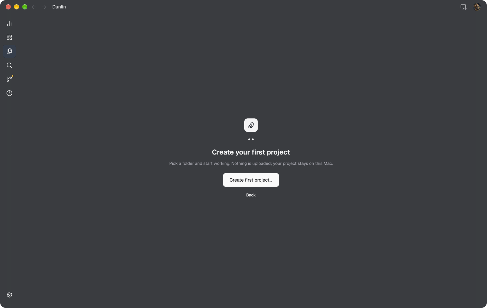
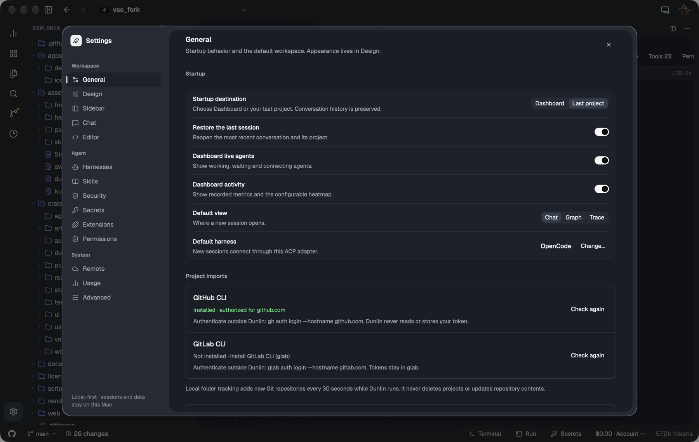
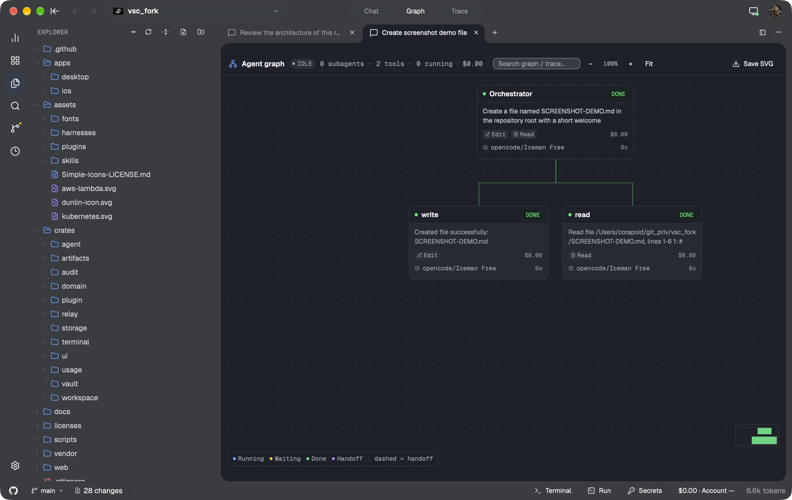
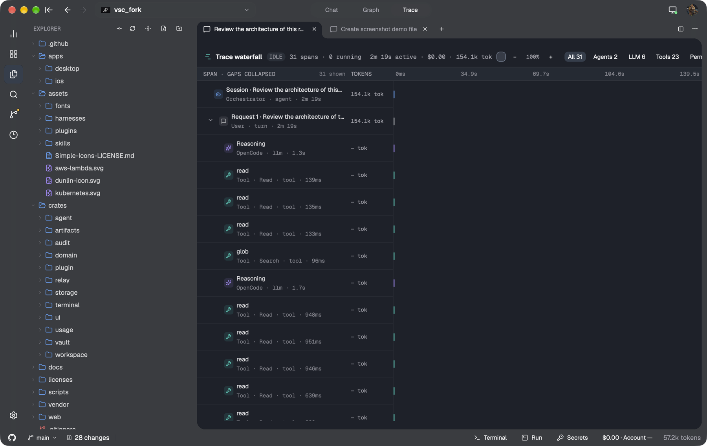

# Dunlin — full guide

This is the detailed reference moved out of the README. For the short project overview, see [README.md](../README.md).

Dunlin pairs a calm, keyboard-driven workspace with a real
[Agent Client Protocol](https://agentclientprotocol.com) client. One app can
drive OpenCode, Claude Code, Codex, a curated ACP catalog or any custom ACP harness, with streaming
messages, plans, tool calls, diffs and permission requests rendered as native
UI instead of a terminal transcript.

The current beta targets **macOS 15+, Apple Silicon, local projects and a
self-hosted relay beta**. The iOS client is a scaffold and is not part of this
release. The latest published beta and source version are `0.1.0-beta.10`; see
[CHANGELOG.md](../CHANGELOG.md). Published checksums, bundle identity/version and
relay architectures were independently verified before advancing download links.

### Beta.10 highlights

- [Server setup](relay-setup.md): interactive macOS/Linux bootstrap, optional
  private Tailscale HTTPS, server-owned harness installation/authorization,
  repository cloning and reviewed project copies with optional Git history.
- [Settings/project backup](settings-project-backup.md): portable JSON or an
  existing GitHub/GitLab repository, import preview and deferred code downloads.
- [Project imports](project-import.md) and [session imports](session-import.md):
  local collections, GitHub/GitLab search, cancellable previews and disk-staged
  history imports with transactional writes.
- Two in-memory document panes share canonical file buffers and agent runtimes;
  moving tabs does not duplicate files or stop conversations. Pane layout is not
  restored after restart. Project search and reading zoom preserve focused input.
- Usage adds rolling billing ranges and cached account limits; Secrets defaults
  to storage-only keys until agent access is explicitly configured.

Publication is not a claim of completed clean-machine acceptance.
See [release acceptance](release-acceptance.md) for the publication boundary.

## Why Dunlin

- **Truly native.** The entire interface is GPUI. The SQLite database is local,
  source control uses the system `git`, and there is no browser runtime in the
  loop.
- **ACP first.** Dunlin speaks the structured Agent Client Protocol directly.
  Tool calls and permission requests become real cards and diffs, not ANSI
  text to parse.
- **Local-first.** Projects, sessions and transcripts stay on your Mac or the
  self-hosted server you select. There is no telemetry, bundled model or Dunlin
  cloud account; external agents and hosting providers have their own accounts.
- **Built for follow-ups.** Queue prompts while a turn is running, edit or
  retry a message, copy the agent's answer, and revisit the transcript later.
- **Self-hosted remote.** Pair the Mac client with your own macOS/Linux relay.
  Sessions keep running on the relay, and another device can take over.

## A tour

<table>
  <tr>
    <td width="50%" valign="top">
      
      <br/><sub><b>Open a folder.</b> No demo projects, no hidden workspace. A folder is all Dunlin needs.</sub>
    </td>
    <td width="50%" valign="top">
      
      <br/><sub><b>Make it yours.</b> Theme, harness, permissions, notifications and keyboard hints.</sub>
    </td>
  </tr>
  <tr>
    <td width="50%" valign="top">
      
      <br/><sub><b>See the plan.</b> Plan steps and tool calls become a live agent graph.</sub>
    </td>
    <td width="50%" valign="top">
      
      <br/><sub><b>See the time.</b> Every turn, model call, tool and permission becomes a trace span.</sub>
    </td>
  </tr>
</table>

## Features

### Back and forward

Use the title-bar arrows, **View → Back / Forward**, or **⌘[ / ⌘]** to revisit
views, sidebar sections, projects, sessions, open file tabs and settings tabs.
New navigation after going back replaces the forward branch. Removed projects,
sessions and closed file tabs are skipped. History keeps the last 100 destinations
for the current app run; it does not undo edits or discard unsaved buffers.
Save or close the current file before navigating to another project.

### Settings reset and floating lists

Floating lists share the host menu's neutral popover style, without dimming the
workspace. **Settings → Advanced → About → Reset…** restores defaults and removes
local project/group/history/harness records and Dunlin-owned credentials after an
explicit warning with **No / Yes, reset Dunlin**. Close other Dunlin instances first.
Repository files and installed agents are never deleted. The app closes after
success; restart for a fresh setup. [Exact reset scope and QA](popovers-and-factory-reset.md).

### Chat and harnesses

- Streaming assistant output, reasoning, plans, tool calls and usage updates.
- Permission cards with allow-once, always-allow and reject choices.
- Unified diffs previewed inline before or after a tool writes a file.
- Prompt queue with edit, reorder, remove and clear while a turn is running.
- Message actions: copy, retry and edit. Agent responses can be copied as
  Markdown.
- Session history with persisted transcripts and interruption recovery.
- **New Standalone Chat** creates an isolated scratch workspace (or, with
  **New Chat in Repository…** / **New Chat in &lt;repo&gt;**, a separate chat
  space bound to an explicitly confirmed folder). Chats live in their own
  sidebar section, never as fake repository projects, and existing project
  sessions never change cwd.
  Details: [standalone chat](standalone-chat-worktree-usage.md).
- Immediate project/session navigation while ACP context and models load. Local
  agents keep their own runtime while another project is visible (up to eight
  connected adapters; idle adapters can be evicted). Pending follow-ups pause at
  background turn boundaries and resume after foreground send guards pass.
  Relay navigation retains its existing disconnect/cancel lifecycle.
- OpenCode (default), Claude Code, Codex and a curated ACP catalog: Gemini CLI,
  Qwen Code, GitHub Copilot, Cursor, Auggie CLI, Kiro CLI, OpenClaw, Hermes Agent
  and Qoder CLI, plus custom ACP commands. Each project can override the harness
  and permission mode. Missing agents show **Install…**, which opens the official
  setup page; detected agents show **Import sessions…**.
- Local **Project settings → Model & environment…** saves a default model ID per
  harness and literal `NAME=value` environment overrides. Model defaults apply to
  new conversations, not resumed ones; unavailable/rejected defaults block activation
  instead of silently using another model. Local environment changes apply to the
  next local connection without restarting running agents and are never sent to
  relay. For a remote project, an administrator can store the same model/env
  defaults on the relay; environment reaches the remote harness at its next
  connection. Values are unencrypted: do not paste secrets.
  Details and limits: [project runtime defaults](project-runtime-settings.md).
- **Right-click group → Group settings…** edits inheritable harness, client
  permissions, per-harness models and local environment overrides. Resolution is
  global → ancestor groups → project, with per-value sources and reset to inheritance.
  Membership changes recompute defaults; group conversations retain their fixed
  project scope and use the strictest effective member policy.
  **Apply saved model to current session** applies its effective model explicitly
  over ACP when idle, without a restart, prompt or changes to other conversations.

### Workspace

- **+** beside conversation tabs (or `⌘N`) opens a separate session tab. Tabs use
  session titles, updated from the first prompt. Switching preserves each draft,
  scroll position, transcript and running agent. Closing a tab hides it only;
  reopen it from session history. An agent awaiting approval stays paused until
  you return to its tab. Tabs/drafts are in-memory; history remains persisted.
- Closing a selected tab returns to the last visited, still-open tab in the same
  pane, rather than the first tab or Chat. Closing an inactive tab keeps selection.
- **⌘⌥P** or the magnifier beside Projects' **+** searches projects by name/path;
  Enter or a result click switches projects, while Escape cancels. The title-bar
  project dropdown uses flat rows; hierarchy indentation remains in the sidebar.
- The title-bar project dropdown only switches projects. Right-click a project in
  the sidebar for its actions (settings, trust, pin, reveal/copy path, locate or
  remove), plus group creation and local/remote project import. **Move to group…**
  opens a separate dialog; project rows no longer have an ellipsis button.
- **⌘+**, **⌘−** and **⌘0** enlarge, shrink and reset workspace text for this run
  (70–200%). Chat, code editors and terminals share the reading zoom; the sidebar
  and Settings keep their normal size. No terminal configuration files change.
- Response headers use the harness and dispatch-time model, for example
  **Claude Code: Opus 5.5 (31.5s)** when turn duration is enabled. Old messages
  without recorded model metadata say **Model not recorded**, not today's model.
  Response logos identify the harness (bundled Claude, Codex, OpenCode, Copilot,
  Gemini and Hermes marks); other/custom harnesses use initials.
- **Settings → Design → Application → System** follows native appearance changes.
  Light/Dark remain explicit overrides. Drag the Settings header to reposition
  the panel; it stays inside the viewport. Compact density also tightens project,
  session and Explorer rows. QA details have a **Close** action like ACP logs.
- The top-bar Search shortcut and minimalist mode were removed. The command
  palette remains available with `⌘K`; source files use their existing tabs
  instead of duplicate filename/editor headers.
- File explorer with a debounced watcher and missing-folder recovery.
- **Settings → Harnesses → Import sessions…** scans the standard Claude Code and
  Codex session folders and reads OpenCode's local `opencode.db` read-only, then
  shows a preview. Portable `dunlin.session.v1` exports remain a separate explicit
  action for other ACP agents. Preview project
  assignments, match canonical local paths automatically and assign unmatched
  histories manually. Imports are transactional and insert-only: no source writes,
  prompts or overwriting existing conversations. These are history copies, not
  resumed source sessions or billing scanners. Formats/limits: [session import](session-import.md).
- **Source Control → graph icon** or **Repository → Branch Graph & History…**
  (`⌘⌥G`) opens the local or relay Git DAG in a main workbench tab, with refs, commit
  messages, changed files and read-only per-file patches. Root commits compare to
  the empty tree; merge commits offer explicit parent selection. Binary and
  mode/rename-only changes show metadata. Chat and dirty file buffers stay intact.
  For local repositories, select any visible
  commit and create a branch without checkout, changing staging or touching dirty
  files. Load up to 2,000 commits, or enter an older commit/branch/tag to inspect
  its ancestry. Relay history requires the updated, project-granted read-only
  API; old relays report an update requirement, never a local/legacy fallback.
  No automatic fetch; remote branch creation is available through the scoped
  history mutation endpoint, while commit checkout remains local-only.
  Details, bounds and QA: [Git history](git-history.md).
- In that Git tab, **Repository state** shows a read-only local or
  relay inventory: stash entries, registered worktrees/locks, ongoing Git
   operations and unmerged index paths. Stash push/apply/pop/drop, worktree
   add/remove/prune and merge/rebase/cherry-pick with continue/abort use fresh plans
   and explicit confirmation, locally or through an updated relay. Buffers are
   preserved; no automatic stash, force or rollback is added.
   Details and pending GUI QA: [repository state](git-repository-state.md).
- **Subtask Worktrees** (command palette) creates one isolated branch
  `dunlin/subtask/<name>` and worktree from an explicit commit. Each creation and
  removal is a separate confirmed Git plan; the durable registry survives
  restart and can reopen the worktree as a project. It never starts an agent,
  merges, pushes or acts as a sandbox.
  [Scope and limits](standalone-chat-worktree-usage.md).
- **Inline blame** in the Explorer toolbar (also Settings → Editor) is remembered
  across files and app restarts. Subtle inline text shows unchanged-line author/commit details
  on hover and opens the commit in history. Unsaved/modified lines get no author.
  HEAD/file/backend caching and relay support are bounded and opt-in.
  [Git operation/blame scope and QA](git-operations-and-blame.md).
- Source Control shows **History**. PR and GitHub Actions integration was removed.
  A GitHub/GitLab.com repository link appears before the branch in the bottom-left
  status bar; other or ambiguous remotes show a neutral placeholder. Link detection
  reads Git configuration only and does not authenticate or contact the host.
  Composer **Context… / Review… / Checks…** opens client-context provenance,
  approved decision memory, explicit saved-file checkpoints/selective restore and
  confirmed local check commands with evidence → draft, never automatic prompts.
  **Budget… / Compare… / Impact…** adds durable request/time/reported-USD limits,
  separately authorized same-commit A/B worktrees with shared limits, and incremental
  Rust AST references/candidate tests. **On a relay project**, the same review,
  comparison and context surfaces use explicit server-side endpoints.
  GitHub topics/import support remains separate from the removed PR/Actions UI.
  Unknown cost/coverage is not zero;
  worktrees are not sandboxes and impact is not compiler/LSP-complete. No paid
  comparison replay on restart, automatic merge or buffer discard.
  [Bounds and pending acceptance](agent-workbench-and-github.md).
- `.md` / `.markdown` files open in **Visual** mode by default, with persistent
  styled text editors, editable table cells and code blocks. Clicking positions
  the caret without changing typography. HTML/metadata remain editable syntax
  fields in Visual; the single header switch opens **Raw**. Edits share source
  undo/save; images/resources and link navigation are blocked.
  The contextual **Table** toolbar menu edits rows/columns/alignment; Tab/Shift+Tab
  navigate cells, with Tab at the final cell adding a row.
  Compact 13 px body text / 12 px code; Enter splits prose and continues simple
  lists, while boundary Backspace/Delete joins compatible blocks with shared undo.
  [Supported scope and limitations](markdown-editor.md).
- **Terminal** (`⌘J`) and **Run** (`⌘⇧J`) share one hideable dock that can be
  dragged to the bottom, left or right edge and resized by dragging its inner
  edge. Terminal opens independent PTY tabs (local, relay or SSH v1) with
  ANSI/RGB rendering, a 5,000-line scrollback, resize, mouse selection
  (word/line/Shift), draggable splits, search, OSC 8 links, shell integration
  (OSC 133/633/7/1337) and copy/paste. Closing a tab kills its process; sessions
  are never resumed after restart. Remote projects use the relay PTY and never
  fall back to a local shell; the SSH button uses OpenSSH config/agent and
  prompts for known hosts. **Run** statically detects Node/Cargo/Make/Just/
  Python/Go/Deno/Composer/Ruby/Elixir/Gradle/Maven and script commands, shows
  exact argv/cwd/env names, asks for confirmation and runs once in a terminal tab
  with exit status, bounded local history and rerun. No manifest code is
  evaluated. [Terminal and Run bounds](terminal-and-run.md).
- **Project settings → Project icon → Choose image…** embeds a bounded PNG/JPEG/
  SVG/ICO as a small normalized PNG; moving the source file does not break it.
  **Automatic** restores repository-icon discovery. The Home heading follows the
  system's local clock/timezone, including while the app remains open. Native
  macOS menus expose Settings, project files, navigation and repository actions,
  with unavailable project actions disabled by context.
- **Add Projects…** (`⌘O`) offers **Local folder** and **GitHub URL or filter**.
  The in-app folder explorer previews how many repositories the selected directory
  contains before import. Collections with multiple repositories offer optional
  root tracking: every 30 seconds while Dunlin runs, new repositories are imported
  without changing the active project or automatically granting trust. Tracking
  survives restart; stop it in **Settings → General → Project imports**. A single
  repository does not offer tracking. Select a collection directory to discover
  its repositories. A selected collection becomes a logical group named after that
  folder; discovered repositories become its projects, not a parent workspace.
  Reimport reuses that group and adds newly discovered repositories. Existing
  ungrouped projects join it; manual group assignments, names, trust, pins and
  settings are preserved. Same-named folders in different locations stay separate.
  With overlapping selections, the closest explicitly selected collection owns
  new projects. Ordinary project/repository roots do not create wrapper groups.
  Canonical roots are deduplicated; batch imports do not activate every repo.
  Discovery stops at Git/worktree roots, skips generated/hidden directories and
  implicit symlinks, and never fetches or executes repository scripts. Limits:
  8 directory levels, 20,000 entries, 256 projects and 8 seconds; partial imports
  report limits/errors until dismissed. Ordinary non-Git folders remain supported.
  GitHub import accepts a direct repository URL or native repository-search query,
  for example `org:example archived:false language:Rust`. It previews the complete
  result list/count before explicit download via `gh repo clone`. Incomplete
  searches and searches exceeding GitHub's 1000-result limit require a narrower
  filter. Choose a destination with the same explorer, or use the default
  `~/Library/Application Support/Dunlin/repositories`; clones are stored beneath
  `<owner>/<repo>`. Existing folders are never overwritten. Failed clone files
  remain for inspection. GitHub imports require project trust before agent use.
  **Settings → General** reports gh installation and active github.com authorization;
  install/authenticate outside Dunlin and use **Check again** to refresh. Details
  and the isolated acceptance command: [project import](project-import.md).
  Declared npm/Yarn, pnpm, Cargo and Go workspaces, or multi-package Nx/Turbo/Lerna
  layouts, get a **Monorepo** badge on projects/tiles; packages stay within one
  root. Project rows keep that marker on the right, show the dominant repository
  language beneath it and reveal the full language breakdown with percentages on
  hover. Explorer file-tree refreshes recover from watcher races and show a
  loading state instead of leaving the pane blank.
- Explorer rows show a file's size or a folder's recursive size on hover, and the
  project root shows the total source size. **Design → Application → Show file
  sizes** turns these labels, the Explorer total and Dashboard tile tooltip size off.
- Create files and folders from the Explorer toolbar or a folder's context menu.
  Drag within a project to move; drop files or folders from Finder to copy them
  into a local project while keeping the originals. Existing destinations are
  never overwritten; save a dirty open file before moving it or its folder.
  Imports reject symbolic links and Git metadata and are limited to 1 GiB,
  20,000 entries, 64 nested levels and 1,000 top-level items per drop.
- Syntax-highlighted editor with dirty tracking, `⌘S`, optional autosave,
  external-change detection and conflict recovery.
- Clickable right-hand file minimap with a visible-viewport indicator. Green,
  amber and red mark additions, replacements and deletions against local Git HEAD;
  a separate blue rail marks unsaved edits and clears on save/Undo. Remote files
  show unsaved edits only. Settings → Editor → File minimap hides the map.
  Overview/diff work runs off-thread with bounded drawing and comparison budgets.
- Independent file tabs and a Chat tab retain buffers, undo and scroll positions
  during this launch. `⌘⇧S` saves all tabs; quit protection covers every dirty tab.
  **Close all** closes the current project's file tabs without stopping Chat;
  dirty buffers offer Save All, Discard or Cancel.
- Bounded PNG/JPG/SVG previews and paged native PDF rendering. Other binary and
  unsupported extensions (including ZIP, AVIF and MP4) are rejected with a toast.
  SVG scripts, external images, DTDs and compressed SVG are not executed/loaded.
  Images and PDF pages fit entirely inside the current preview viewport, including
  after resizing the window or sidebar.
  Preview bitmaps go directly to the renderer without a PNG encode/decode round
  trip. PDF rendering handles page rotation/crop origins and keeps a bounded LRU
  cache of rendered pages; SVG system fonts are loaded once and only when needed.
- Explorer rename, delete and Reveal in Finder. Local deletion uses system Trash
  with confirmation; remote deletion only removes files or empty folders. Dirty
  and loading tabs protect mutations; renames never replace existing items.
- Project search that skips build, VCS and secret files.
- Source control backed by the system `git`: status, stage, unstage, discard,
  commit, amend, pull, push, branches and read-only diffs.
  Non-repository folders show a normal empty state with an explicit Initialize
  repository action; no automatic initialization, staging or commits.
  Clicking a change opens its staged or unstaged diff (including new files),
  loaded off the UI thread instead of opening the editor.
- Click the branch badge on a Dashboard tile, in Source Control or on the status
  bar to search local branches (`↑↓`, Enter, Esc). The command palette also has
  **Switch branch…**. The picker loads repository state asynchronously and does
  not start agents or change project/session selection on Dashboard.
  The full picker has a fixed height during loading, filtering and errors, with
  a scrollable branch list. The bottom status-bar branch badge opens a small
  searchable list immediately above the badge, using the same backdrop as dialogs;
  click outside or press Esc to close it. Both use the same safe checkout flow.
  Unsaved project buffers offer **Save all and continue** / Cancel, never Discard.
  Git changes require separate **Keep changes and switch** consent with staged,
  unstaged and untracked counts. Native Git refuses overlapping edits, untracked
  collisions, ignored-file overwrites and branches held by another worktree.
  No automatic stash/pop, reset, forced checkout, merge, commit or branch creation.
  A changed preflight, unresolved Git operation, dirty/loading buffer, active
  project/group agent or competing Dunlin mutation stops the operation. In-flight
  switches retain their lock even if the picker closes, and prevent quitting until
  Git completes. External editors/Git clients and repository hooks are not sandboxed.
- Agent graph and trace waterfall projected from the live transcript.
- Nested logical project groups, pinned ordering and per-project settings.
  Projects use the group tree only; sort by **Name ↑ / Modified ↓**. Modification
  sorting uses cached Git/worktree timestamps rather than a recursive file scan.
  Group membership is unchanged. Right-click the
  **Projects** heading or its list for **New group… / Add projects…**;
  right-click a group for **New subgroup…**, rename/delete and **Move group to…**.
  Drag group headers to reparent them; cycles are rejected. Deleting a group
  promotes direct projects and subgroups one level. Undo restores eligible members
  without overwriting subsequent moves, touching files or changing conversations.
  Existing groups migrate to top level without resetting histories/settings.
- Resize the sidebar by dragging its right edge (220–560 points, clamped to the
  window); release to save its width, or double-click the edge to reset to 278.
- Drag project rows onto group headers (organization only; no disk moves).
  Whole group sections now accept drops, with destination labels, strong outlines
  and a readable floating project card while dragging. Each group has an explicit
  neutral agent icon next to Edit, with a scope explanation and a project count
  in the group heading. New conversations include descendant groups' projects.
  The group's agent action creates a conversation with a frozen manifest of
  1–32 trusted local project roots, attached to every request without reading
  their files or automatically sending a prompt. A short context prefix explains
  that the group is one logical multi-repository project, names its repositories
  and gives their absolute paths. It is client-supplied context in the ACP user
  message, not an override of the harness's system prompt. Each repository's Git
  state remains independent; the parent folder is not an extra filesystem grant.
  The strictest member approval
  policy applies. This is explicit agent context, not a filesystem sandbox;
  it does not widen remote grants or include future group members.
- Dashboard is the first sidebar destination, with live working/waiting/connecting
  agents, seven-day totals and a configurable 144-day dot activity map using the
  application palette. On Dashboard, the top titlebar switches activity metrics
  rather than conversation views. A centered, width-limited content column keeps
  tiles, metrics, dots and captions balanced; short dashboards center vertically,
  while taller content remains scrollable.
  Activity totals/captions are centered as one column. Light mode uses muted dots
  without glow and visible recent-project tile borders; data caveats stay in the
  Dashboard's bottom footer, outside its content scroller.
  When no sessions are active, up to three recently
  used projects appear as clickable tiles, based on persisted user visits and
  recorded user requests (not background agent output).
  Recent-project tiles keep a larger identity icon, the Monorepo badge, the branch
  selector and a compact **Open** action on one row. Project size, last commit,
  upstream state and check time live in the tile's info tooltip. Only visible
  recent trusted local projects automatically run a read-only, timeout-bounded
  `git ls-remote` check (two-minute cache; refresh icon for an explicit recheck).
  Fresh observations carry a check time; cached local tracking counts are labelled
  separately. Missing upstreams, deleted branches and failed checks stay distinct.
  Known objects allow exact ahead/behind counts; an unknown advertised commit says
  **fetch needed to compare**, never an invented behind count. No automatic fetch,
  pull, merge, tracking-ref update or authentication dialog is requested. Relay
  workspaces currently show an unavailable/local-check state rather than probing
  the relay or borrowing another repository's status.
  Recent tiles, the project list and switcher share one project icon. Trusted
  local projects automatically use literal HTML favicon links, web-manifest
  icons, Next.js file-based icons or conventional favicon/logo assets (SVG,
  PNG, JPEG and ICO). Detection runs off-thread, refreshes periodically and on
  active-project file changes, and falls back to the existing colored monogram.
  It never fetches external URLs, executes repository config, invokes AI or
  creates `AGENTS.md`; remote/untrusted projects retain their monograms.
- Chat opens without the redundant session-information band. Session actions and
  the reasoning toggle remain in the titlebar; transcripts are unchanged.
  The Sessions sidebar and its count hide unstarted drafts, including adapter-only
  failures, until a user message is recorded. Drafts are not deleted; existing
  histories remain available when transcript reads fail or remote data is loading.
  The list separates **General sessions** (standalone chats and group conversations,
  labelled with their context) from **Project · name** (the current repository's
  own conversations). General sessions remain visible when switching projects;
  opening one selects its owning workspace and transcript. Each section sorts
  newest first. Deletion still requires confirmation and does not change the
  current conversation when deleting history from another workspace.
  Metrics use recorded requests, reported token deltas and tool-reported diffs
  only, not context occupancy or inferred Git history. Missing data stays unknown.
  Settings → General chooses visible widgets and Dashboard/last-project startup.
- Collapsible Account usage and an animated sidebar. Settings and branch panels
  use localized native **Liquid Glass** on macOS 26+, or AppKit's translucent
  Popover material on macOS 15+. A transparent, owner-attached render plane puts
  glass below the panel's sharp text/controls and above the application scene.
  Rounded glass follows measured panel bounds, including borders and resizing;
  panels have a 14% tint with a subtle border/shadow. Branch layouts remain
  530 × 460 and 300 × 170 points.
  The main window gets only 12% dimming and a weak HeaderView material at 14%
  alpha, never full-window Liquid Glass. Menus remain sharp; nested application
  dialogs do not accumulate dim layers. Native confirmations/file pickers track
  their lifetime with shared leases and clean up on completion/cancellation.
  Native materials do not intercept input, capture the screen, write files or
  override macOS Reduce Transparency preferences. Glass is runtime-gated to keep
  macOS 15 compatibility; a failed panel window falls back to in-window rendering.
  Trace separates idle/unrecorded gaps and compresses them on the
  active-time axis rather than extending the preceding response.
- Settings is larger and fits the window (up to 1120 × 760 points), with an
  opaque, flat surface that avoids light-theme glass artifacts and keeps the
  active section marked by a quiet rail. **Design → Application / Sidebar**
  groups appearance controls, while **Chat** and **Editor** have dedicated tabs,
  including **Comfortable / Compact** semantic spacing and **Reduce motion**.
  Compact keeps hit-target floors instead of shrinking controls blindly.
  **Design → Sidebar → Show branch names** hides project-list branch
  labels independently of Git changes and branch controls elsewhere.
- **Settings → Permissions** includes a macOS permission center for
  Notifications, Accessibility, Screen Recording, Automation and Full Disk
  Access. It distinguishes granted/denied/not-determined/not-granted/unknown,
  opens the right System Settings pane and rechecks without granting anything or
  triggering a request. Notifications can be requested explicitly; the status is
  cached briefly so rendering settings does not block on TCC.
- Onboarding stays focused on the folder choice. Notifications and the other
  macOS permissions are reviewed—and requested explicitly—later in
  **Settings → Permissions**. An untrusted project shows a **Trust project**
  banner in Chat and cannot start an agent or runtime until trusted.
- Long imported conversations render the newest 120 items first; **Show earlier
  messages** expands the window without rebuilding the whole transcript. Sending
  a prompt returns to the live edge.

### Skills and AI commits

**Settings → Skills** maintains one persisted instruction library for all projects.
Add, edit or delete skills, scan the default harness folders, import a folder
containing `SKILL.md`/skill directories, or paste a GitHub link to a public
`SKILL.md`/skill folder. Install/update global copies with the
OpenCode, Claude Code or Codex buttons, or install project-scoped copies for the
current local project. **Other folder…** exports to a custom harness's global
skills directory. These buttons do not install harness programs,
sign in, change their settings or send AI requests. Review instructions first:
agents may execute the tools they describe.

| Harness | Default global skills directory |
| --- | --- |
| OpenCode | `$XDG_CONFIG_HOME/opencode/skills` or `~/.config/opencode/skills` |
| Claude Code | `$CLAUDE_CONFIG_DIR/skills` or `~/.claude/skills` |
| Codex | `~/.agents/skills` |

Exports contain instructions only, at `dunlin-<id>/SKILL.md`; scripts, references
and other supporting files are not imported or synchronized. Discovery records
the source path and SHA-256 without claiming ownership of existing files. Library edits do not
silently update installed copies. Updates/removals require the recorded contents
to remain unchanged: unmanaged files, external edits and symlinked skill files or
directories are preserved. Removing a skill never recursively deletes supporting
files. Project-level definitions may override global skills; a running harness
may need a new session to discover an installation.

When local AI authentication and the last used model can be verified, Source
Control shows **Commit on AI** instead of the commit-message field. It uses the
exact harness, model and OpenCode provider/filter recorded at the last dispatched
request, not merely the current picker selection. Missing model metadata or an
unavailable target never selects another provider/model. Otherwise the original
manual commit form remains available, also via **Manual commit**.

The action asks for confirmation that it may consume paid tokens and create
commits, then opens a separate conversation using the bundled, editable
**Conventional commits** skill. The skill reviews repository policy and recent
history, groups coherent changes into as many Conventional Commits as warranted,
preserves partial staging and staged scope, and forbids pushes, history rewriting,
secret commits and hook bypasses. Its library instructions are injected directly;
using the action does not automatically install global files.

AI commit preparation requires a trusted local repository root, saved buffers,
no conflicting Dunlin agents/file or Git operations, no unresolved Git operation
and nonempty changes. Navigation or cancellation invalidates preparation. While
the agent runs, Dunlin blocks competing mutations and other agents in that
project. Normal approval gates remain in effect: this is not a filesystem sandbox
and does not lock out external Git clients or editors. Authentication checks use
metadata/status only, never a test prompt. Remote projects and custom ACP auth
contracts currently retain manual commits. Histories/settings are preserved;
pending AI commit requests are not resumed after restarting Dunlin.

### Secrets

**Settings → Secrets** and the bottom **Secrets** panel save **Name + Key** pairs
in the macOS Keychain, without expiry or agent access. **Configure agent access…**
adds host, TTL, injection and optional write methods so an agent can use a key
without receiving its value. Configured quick keys are short-lived (default
1 hour, maximum 24 hours) and inert until granted to a project. Managed quick keys are auto-approved only for their exact
host/path/method/operation scope. Enable **require approval** to prompt for each
use with **Deny**, **Allow once** and **Allow for this session**; editing the key
invalidates existing session allowances. Read-only mode allows GET/HEAD only and
refuses CLI recipes.

The harness gets an MCP tool surface: `secrets_list` discovers aliases, scopes and
named operations, `secrets_request` performs an HTTPS request with the credential
injected by the app, and `secrets_run` runs a fixed, hash-pinned CLI recipe. A
named operation fixes the method, host and path template and exposes only
declared path parameters, so the model cannot choose another endpoint. Injection
can be a header, Basic auth, query parameter, OAuth 2.0 refresh or AWS SigV4; the
OAuth exchange and AWS signing happen inside the broker, and both the stored
value and exchanged token are redacted from results. If you enable the
broker after a harness is already connected, restart that harness (Settings →
Secrets or the bottom panel offers the action) so its next `session/new`/load
can receive the MCP server. Dunlin executes the
request or command itself; the value never enters the model context, the harness
environment, argv, project files or SQLite. The security policy is stored in the
Keychain, so editing the local display database cannot widen it. There is no
reveal, export or clipboard action for a stored value. Provider sign-in for the
model itself is separate.

Local harnesses still run with the user's permissions; this is a use-only
capability, not a sandbox. See [use-only credentials](secrets.md) for the policy,
threat model and limitations.

### Security workspace

The **Security** rail section is an installation and launch surface, not a
built-in scanner. It offers the pinned, MIT-licensed Cloudflare
`security-audit-skill` bundle as a recommended catalog entry. The bundle is
embedded in Dunlin with its companion playbooks, JSON schema, validators and
license; installing it copies every file together into the selected harness's
global or project skill directory. The same catalog entry is available in
**Settings → Skills**, and both surfaces offer installation when the skill is
missing.

Skills now support multi-file bundles. Folder import reads bounded, UTF-8
regular files below the selected skill directory (never symlinks), preserves
relative paths and hashes every file. Updates require all Dunlin-managed files
to remain unchanged; uninstall removes only verified managed files and leaves
supporting user files and the directory in place. GitHub-link import still
fetches only `SKILL.md`; use folder import for multi-file bundles.

**Start audit in chat** creates a dedicated conversation with the installed
skill path and a source-only Phase 1 prompt. It does not execute target code or
run the scanner itself. Artifacts go to
`~/Library/Application Support/Dunlin/audits/<project>/run-<id>/` and the
harness's normal permission prompts still apply.

The Security view also reads completed or in-progress run directories. It
supports Cloudflare `findings.json` and `coverage-ledger.json`, Codex Security
`findings.json` and `coverage.json`, and SARIF 2.1.0 exports produced by Codex
Security. It validates
bounded structure, repository-relative paths, verdict branches, duplicate
fingerprints and coverage IDs, then shows findings, evidence, coverage, report
text and structural errors. Raw artifacts remain authoritative. An empty
findings file, a missing coverage file or a valid parse is never presented as
proof that a repository is secure; `confirmed` is limited to Cloudflare records
whose workflow supplies the required evidence, while Codex and SARIF results are
labelled `Reported`. Runs refresh while an audit is still active. A run linked to a Dunlin
conversation can reopen that chat; once coverage exists, **Continue to hunting**
prepares a Phase 2 prompt but does not send it automatically. **Export SARIF**
writes `dunlin-results.sarif` beside the run artifacts without changing the
saved findings. When the same fingerprint appears in more than one loaded run,
the finding detail reports the occurrence count but never merges evidence
automatically.

Finding detail also keeps a local triage state: open, accepted, false positive,
fixed or won't fix. Triage is keyed by source and fingerprint, is stored in
Dunlin settings, and never edits the audit artifact. A triage decision does not
change a verdict or severity. The detail view can start a fresh verifier session;
the verifier is instructed to try to disprove the candidate and writes a bounded
`verification-*.json` record back into the run directory. Dunlin displays the
newest decision but never applies it to the original finding automatically.

The run header advances an explicit phase sequence: reconnaissance, hunting,
validation, reporting, verification and complete. Each **Continue** action
prepares the next phase prompt in the linked audit conversation and records the
phase in `dunlin-run.json`; it does not send the prompt automatically.

**Codex Security CLI.** When `codex-security` or `cs` is on the absolute PATH,
the Codex card can start an explicit `scan` into
`<run>/codex-results`. The external CLI owns authentication, provider policy,
network access and its sandbox; Dunlin only starts the argv after confirmation
and reads saved artifacts back. Codex findings expose `Patch with Codex` and
`Verify fix with Codex`; patching requires a clean working tree, a separate
confirmation and never creates a commit or push. `npx` and repository-local
binaries are never invoked implicitly.

**Exports.** A run can export SARIF, normalized JSON, CSV and Markdown beside its
artifacts as `dunlin-results.sarif`, `dunlin-findings.json`,
`dunlin-findings.csv` and `dunlin-report.md`. Exports do not rewrite the
canonical findings or reports.

**Sandboxed local check.** The Security view can run one explicit JSON argv in a
macOS seatbelt profile with network denied, writes restricted to a private
scratch directory, common credential reads denied, and bounded wall-clock, CPU,
file-size and process limits. This is a native local check runner; it is not a
container and it does not sandbox the ACP harness.

Dunlin intentionally does not import arbitrary third-party scanner reports.
Only Cloudflare audit artifacts and Codex Security results are supported; files
from other scanners are left untouched and shown as unsupported rather than
silently treated as findings.

**Remote projects.** Remote audits use `.dunlin/audits/<run-id>/` on the relay
host. The relay exposes only bounded, allowlisted audit artifacts for the
granted project (`/v1/audits` and `/v1/audits/file`); the client keeps a local
read-only cache so the same parser and findings UI work. Starting a remote audit
creates the remote directory, writes `dunlin-run.json`, and prepares the Phase 1
prompt in a relay ACP session. Keep `.dunlin/` out of Git history. Remote phase
prompts are prepared in the linked session; remote verifier writes and remote
Codex CLI execution remain separate limitations.

**Settings → Security** has a global **Enable Security workspace** switch. When
disabled, Dunlin hides the Security rail item, command-palette entry, audit
views and the Cloudflare audit catalog recommendations. It does not uninstall
skills, delete run artifacts, revoke permissions, or change Codex Security;
re-enable the switch to inspect the same local files again.

**Codex Security** is deliberately external. Dunlin does not bundle or
reimplement its scanner, CLI, patches or verification. The Security surface only
links to the Codex Security documentation and harness settings and explains that
the plugin requires a Codex/OpenAI harness.

### Remote relay

- Self-hosted `dunlin-relay` with accounts, devices and project grants.
- One-time pairing codes valid for at most 15 minutes; device tokens live in the
  macOS Keychain and remain valid until revoked.
- A named server workspace manages server-owned harnesses and accounts even
  before a project or harness exists; no local agent installation is needed.
- ACP over WebSocket with session leases and explicit takeover.
- Transcript snapshots so another device can show history.
- Explorer file/folder creation, internal moves and Git initialization require
  an updated relay (`/v1/fs/mkdir`, `/v1/fs/move`, `/v1/git/init`). Finder imports
  are local-only; remote Explorer does not upload dropped Mac files.
- Preview, rename and non-recursive delete also require the updated relay
  (`/v1/fs/preview`, `/v1/fs/rename`, `/v1/fs/delete`) and the same project grant.
- Safe branch switching requires the updated relay's `/v1/git/branch-context`
  and `/v1/git/switch-safe` endpoints and the existing project grant. Older relays
  show an update error; Dunlin never silently falls back to legacy checkout.
- Optional aggregate billing evidence sync: members may `POST
  /v1/billing/evidence` (bounded, no raw logs/prompts); only relay administrators
  may read the per-device aggregate. Upload is always an explicit Usage action.
- macOS seatbelt or Linux bubblewrap for harness isolation. Managed agent homes
  and tools have separate server directories; see the migration/trust boundaries
  in [server setup](relay-setup.md).

## Install

### Download the beta

The current beta is ad-hoc signed because there is no Apple Developer ID yet.
macOS Gatekeeper may ask you to approve the app in
**System Settings → Privacy & Security**.

The quickest install is the Homebrew beta channel:

```sh
brew trust corapoid/tap
brew install --cask corapoid/tap/dunlin@beta
```

Release artifacts are published on the
[releases page](https://github.com/corapoid/dunlin/releases):

- `Dunlin-<version>-macos-arm64.dmg`
- `Dunlin-<version>-macos-arm64.pkg` (unsigned installer for `/Applications`)
- `Dunlin-<version>-macos-arm64.zip`
- `dunlin-relay-<version>-macos-arm64.tar.gz`
- `SHA256SUMS`

Beta.10 also publishes
`dunlin-relay-<version>-linux-x86_64.tar.gz` and
`dunlin-relay-<version>-linux-arm64.tar.gz`, plus `install-relay.sh`,
`install-harness.sh` and `RELAY-SHA256SUMS`. `RELAY-SHA256SUMS` covers all three
relay archives and the bootstrap scripts; `SHA256SUMS` remains the macOS package manifest.

The app requires macOS 15 or newer on Apple Silicon. Intel Macs are not
supported in 0.1.

### GitHub Packages (OCI)

The macOS release packages are also published as an OCI artifact:

```sh
oras pull ghcr.io/corapoid/dunlin:beta -o dunlin-beta
```

Open the DMG or `.pkg` inside `dunlin-beta`, then verify the files against
`SHA256SUMS`. The package page is
[github.com/corapoid/dunlin/pkgs/container/dunlin](https://github.com/corapoid/dunlin/pkgs/container/dunlin).
`oras` is available from [oras.land](https://oras.land) or Homebrew.

### Build from source

Requirements:

- macOS 15 or newer on Apple Silicon
- Rust 1.92 or newer (`rustup` recommended)
- `git` on `PATH`
- An ACP harness for real agent work, for example `opencode acp`

```sh
git clone https://github.com/corapoid/dunlin.git
cd dunlin
cargo run -p dunlin
```

The first launch creates `~/Library/Application Support/Dunlin/dunlin.db` and
shows onboarding. Set `DUNLIN_DATA_DIR` to use a different data directory.

To build a local app bundle:

```sh
./scripts/bundle-macos.sh --build
open dist/Dunlin.app
```

The bundling script also checks standard Rust/rustup installation directories
if Cargo is missing from `PATH`, including Homebrew's keg-only rustup on macOS.

The script renders `assets/dunlin-icon.svg`, writes `Info.plist`, copies the
license notices into the bundle and applies an ad-hoc signature. To sign with a
Developer ID:

```sh
DUNLIN_CODESIGN_IDENTITY="Developer ID Application: Your Name (TEAMID)" \
  ./scripts/bundle-macos.sh --build
```

## Harnesses

Open **Settings → Harnesses** (`⌘,`) to choose the default harness and edit the
custom ACP command. Dunlin checks whether each command is installed and
connects when a project opens.

Onboarding lists detected agents, including CLI-only installations marked
**CLI detected · adapter needed**. **Set up…** opens in-app setup instructions;
**Choose another / Show all** expands the supported catalog. In onboarding, only
detected ACP adapters can be set as the default. Use **Scan again** after installation;
onboarding also rescans when you return to Dunlin. Detection checks the executable,
not whether the adapter can connect or is signed in.

Permission statuses refresh in the background when you return from System
Settings. **Settings → Permissions** also provides **Recheck**, without
requesting new permissions.

| Harness | Command |
| --- | --- |
| OpenCode | `opencode acp` |
| Claude Code | `claude-agent-acp` |
| OpenAI Codex | `codex-acp` |
| Gemini CLI | `gemini --acp` |
| Qwen Code | `qwen --acp` |
| GitHub Copilot | `copilot --acp` |
| Cursor | `cursor-agent acp` |
| Auggie CLI | `auggie --acp` |
| Kiro CLI | `kiro-cli acp` |
| OpenClaw | `openclaw acp` |
| Hermes Agent | `hermes acp` |
| Qoder CLI | `qodercli --acp` |
| Custom ACP | Any command that speaks ACP over stdio |

The default is OpenCode. Permission modes are **Ask every time**, **Read-only**
and **Auto-approve**. ACP permissions are never auto-approved by the relay.

Click the model dropdown in the composer to choose a model advertised by the
connected harness. Model changes are confirmed by the harness; not every ACP
agent exposes selectable models. Local conversations resume their ACP session
when the harness supports loading sessions. If resuming fails, the saved history
is kept and Dunlin asks you to start a new session instead of silently resetting
the agent's context.

New conversations are remembered even when the Chat tab is already selected.
On startup, an unused conversation containing only connection failures from a
missing harness can recover to the newest existing conversation for the
available project/default harness. Conversations with user/agent content or an
ACP session ID are never skipped or migrated this way. Missing local ACP commands
show setup actions instead of repeated spawn errors; signing into a harness's
own CLI does not install its separate ACP adapter. Startup failures are not
automatically retried. Consecutive historical errors are grouped visually without
deleting their saved entries.

The title-bar host button shows the current host and a connection-status dot.
Its menu selects **Local host**, a paired **remote relay**, or the existing
**SSH** terminal entry; choosing another host opens a project there rather than
relocating a running conversation. The chat composer keeps inline dropdowns for
**harness**, **agent mode / tool permissions** and **model**. New conversations
start with a centered composer. **Enter** sends a message; **Shift+Enter** inserts
a new line (`⌘Enter` also sends). Agent modes (for example Plan or Build) come
from the harness, not from hard-coded prompts; unsupported modes are not offered.
Changing the local harness starts a new conversation and preserves the old one.
The harness picker shows names only for installed adapters and a configured Custom
ACP command. **Settings → Harnesses → Shown / Hidden** controls visibility in
selection lists, including project/group defaults. This preference is saved and
included in settings backups; it does not uninstall adapters or alter existing
conversations/defaults. Settings retains the full catalog. A repository-context picker for
project-independent chat is planned under Standalone chat in the roadmap.

### OpenCode accounts, Free and Go

**OpenCode** remains the ACP harness; **OpenCode Go** (`opencode-go`) is a
provider inside it, separate from regular `opencode` billing. For local OpenCode
conversations, select the provider in the composer (Go is the initial filter).
The provider picker beside the OpenCode harness shows **Sign in…** only while
the selected provider has no available account connection. It disappears after
successful sign-in, including across restarts; **Add / reconnect account…** stays
in the provider menu. Public OpenCode connection metadata is the source of truth,
not a persisted Dunlin authentication flag. These controls are not shown for Claude Code,
Codex or other ACP harnesses: their own clients manage account authentication.
The model picker only offers that provider's enabled models also advertised by
ACP. Its first section contains up to three recently used models, with no
duplicates, scoped to that provider, harness and environment and saved across
launches. Models no longer available are omitted, including from recents.

**OpenCode Free** is an explicit UI filter, not an additional provider or plan
identifier sent to OpenCode. It offers only enabled `opencode` models advertised
by ACP whose discovered input, output and cache prices are all zero in every
pricing tier. Unknown/missing prices and Go-only promotions are excluded. The
original `opencode/model` IDs are preserved; recents and sending use the same
allowlist. An empty or failed catalog never substitutes a paid model. Free model
availability, limits and privacy policies remain controlled by OpenCode.

Use **Connect provider account…** in the provider menu, or
**Settings → Harnesses → OpenCode provider accounts**. This opens the official
provider sign-in dialog inside Dunlin, with the methods advertised by OpenCode.
The dialog resolves the provider's current `integrationID` even if discovery has
not finished. When OpenCode maps Go to its Console integration, browser account
sign-in is preferred and completion is detected automatically; Free uses the
regular OpenCode account integration. API keys remain available for integrations
that advertise them, including genuinely key-only Go setups. Required
provider-specific forms without defaults are not silently bypassed.

Keys and authorization codes are held only for submission, sent in authenticated
HTTP bodies to the verified local OpenCode service and persisted by OpenCode,
not Dunlin. They never enter subprocess arguments, temporary scripts, logs or
chat history. Redirects and environment proxies are disabled for authentication.
Models and the existing ACP session refresh automatically after connection,
without discarding conversation context. **Refresh providers / models** remains
available for changes made outside Dunlin. Remote OpenCode HTTP services are not
supported by this local sign-in dialog.
Empty startup catalogs are retried a bounded number of times and checked again
after ACP session initialization; persistent discovery failures are shown with
an explicit refresh action rather than silently appearing as a Go-only catalog.

Switching the provider filter does not silently change a session's model:
choose one explicitly before sending. Dunlin blocks sending through a model
from a different provider and keeps the composer text. Account connection counts
and advertised models do **not** confirm balance or subscription entitlement.
On remote projects, authentication and provider configuration belong on the
relay; Dunlin never uses this Mac's account catalog for those conversations.

Chat keeps each kind of information in one place: the conversation header owns
its title, status, project, branch and message count; the title bar owns host,
environment and new-session actions; the composer owns harness, provider, mode
and model selection; the status bar owns connection state, cost and context
usage. Assistant message headers show the speaker rather than
repeating the current global model/harness for every historical response. Model
labels omit the selected provider's prefix without changing model IDs. Reasoning
can be toggled from the conversation header; starter suggestions only appear for
an empty chat. Detailed diagnostics remain in settings, Graph and Trace.

The sidebar's **Account usage** panel follows the active environment, harness
and (for OpenCode) provider filter. It never mixes Claude Code, Codex and OpenCode
accounts, or uses the local Mac's accounts for remote projects. Only the selected
local harness is probed. Codex uses its app-server; supported OpenCode services
provide Go allowance windows or applicable Console budgets via the location-scoped
usage-limits API. Free does not inherit paid-plan allowances. Unsupported services
or providers show **Limits unavailable**, without estimated percentages. ACP
context usage stays separate in the status bar and session details. The activity
rail uses the same active account data instead of a fixed percentage. Usage
refreshes on selection changes, connection, sign-in, completed turns and manual
refresh; late responses from a previous selection cannot replace the active data.
The Go/Console limits endpoint requires a running OpenCode service at **2.2+**.
Updating the CLI does not update an already running service: finish active turns,
then run `opencode service restart` and refresh usage. Older services show this
requirement explicitly; the panel also links to Console for checking usage there.

Chat opens conversations at the latest message and follows streaming replies
while the reader stays near the bottom. Scrolling up pauses following; **Jump to
latest** resumes it. Sending a message also returns to the live edge. Message
content keeps its natural height instead of being compressed behind the composer.

Model menu entries are single-line display names without decorative stars or
wire IDs. The composer keeps **Attach** and replaces Mention / Tools with an
**MCP** menu. For local OpenCode, its count is connected servers not excluded by
this session; agent/provider policies can impose additional restrictions. The
menu shows server status and lets an idle conversation exclude a server using
session permissions. This takes effect on the next turn without restarting the
session, disconnecting a shared server, or changing project/global MCP config.
Excluded tool definitions and server guidance are omitted by OpenCode; earlier
tool output and instructions already in the conversation are not erased. Dunlin
only removes exclusions it created and never relaxes existing user policies.
Ambiguous normalized server names are read-only to avoid affecting another
server. Other harnesses/relays show an unknown count rather than this Mac's MCPs.

Enable **Settings → Chat → Final answer only** to hide reasoning, plans, tools,
subagent output and intermediate assistant text in Chat. **Stream responses**
is independently configurable and enabled by default, including in final-only
mode: the current root reply appears as chunks arrive. Turn it off to wait for
completion. A harness that sends text only at completion cannot be made to
stream by the UI; no artificial typing delay is added. Permission gates and
errors remain visible.
The setting persists across launches and does not remove recorded history.
Graph defaults to agents and actual delegated sessions only. Click an agent to
show/hide its tools; plans and tool calls never masquerade as agents. A linear
tidy-tree auto-layout handles arbitrarily deep subagent chains, packs
variable-width siblings and never overlaps cards when zoomed. Search keeps
matching nodes and their ancestor path visible. **Save SVG** exports the currently
disclosed tree through a native save dialog, including offscreen nodes. The
viewport creates elements only for visible cards/edges; the minimap aggregates
10k+ nodes into a bounded status grid. **Fit** scales and centres the current
graph. A compact minimap and geometry zoom controls provide orientation; `⌘+`,
`⌘−` and `⌘0` control workspace text without moving keyboard focus away from chat.
Trace defaults to user
requests, with per-request disclosure, **Requests** to collapse details,
**Expand all**, search, sticky axis labels and row-density zoom. Rows are
virtualized, so a 10k-row run asks the renderer only for the visible slice. Kind
filters retain parent requests so matching events remain navigable. **Reduce
motion** in Design disables decorative entrance/pulse animation without hiding
status.

Graph and Trace are keyboard trees. Tab focuses the active tree; Up/Down,
Home/End and PageUp/PageDown move selection and scroll it into view, Left
collapses or moves to the parent, Right expands or enters the first child,
Enter/Space toggles disclosure and Escape clears selection. Search, filters and
collapse normalize the selection instead of leaving focus on a hidden row.
Screen readers get tree-item roles, labels, descriptions, level/sibling
positions, selected/expanded state and the active descendant. Full VoiceOver,
both-theme and narrow-window acceptance remains a manual R11 item.
Tool nodes are grouped under their owning subagent when origin metadata is available. OpenCode's child-session metadata
and message IDs are retained so interleaved child/reasoning chunks do not split
or pollute the root reply. Assistant answers render as Markdown, including
headings, emphasis, tables, lists, links and fenced code; links open only on click
and only for HTTP(S) or mailto URLs. Copying an answer preserves its Markdown.

New conversations start **Ready**, not Waiting. Graph and Trace show an empty
state until the conversation has actual events; they never substitute demo
agents, tools, costs or timings. Waiting is reserved for permission requests.

**Settings → Editor** has installed-font pickers for the interface and code.
Selections persist, apply immediately and survive light/dark theme changes.
The read-only preview uses the same editor as project files, reflecting code
font, size and word wrap without editing or autosaving a real file. Geist and
Geist Mono remain the bundled defaults/fallbacks; fonts are not downloaded.
Explorer and search results use colored, type-specific file icons, including
web source, config, package manifests, lockfiles, media, databases and archives.

**Settings → Chat** groups message times (local timezone), elapsed agent-turn
duration in parentheses, response logo, reasoning and final-answer-only options.
The streaming preference is saved here too. Trace has a separate token column:
ACP context-window occupancy is never shown as consumed tokens. If a harness
provides the optional cumulative end-turn usage extension, Dunlin records the
snapshot and attributes only verified counter differences to requests. A new
session has a known zero baseline; after resuming, the baseline is unknown until
a fresh snapshot arrives. Unreported per-model/per-tool consumption and legacy
usage remain **—**, not zero or an estimate.
**Settings → Usage** also contains local billing evidence. A bounded, read-only
scan reads Claude Code JSONL, Codex rollout JSONL and OpenCode's SQLite message
store, dedupes provider message ids and checkpoints complete JSONL lines. It
reports global totals plus per-provider, per-harness, per-model, per-project,
per-work-attribution and daily slices. Attribution is explicit:
**Main conversation**, **Subagents**, **Internal / synthetic** and
**Unknown attribution**; unknown is never assumed to be main work or $0.
Unknown models remain **unpriced**; the visible total is a lower bound, never a
fabricated zero. Optional monthly alert budgets ($50/$100/$250) warn at 80% and
alert at 100% of known priced spend. Scanner limits are 2,000 files, 32 MiB total
and 1 MiB per line. **Copy QA report** exports aggregate evidence, source
files/offsets/states, unpriced models and warnings — never prompts or log
contents. **Sync evidence** explicitly uploads the aggregate to paired relays;
relay administrators can read per-device evidence, members cannot. Importing
harness sessions refreshes the dashboard totals and starts a billing scan
automatically; the dashboard no longer duplicates the billing evidence card.
Scope and manual QA: [standalone chat, worktrees and billing](standalone-chat-worktree-usage.md).

Times/duration are optional; unknown legacy timestamps and durations are not
invented. Newly recorded turn duration starts when the prompt is dispatched and
ends at completion/cancellation/error, including tools and approval waits.

Account limits are cached per environment/harness/provider (and model only for
Console budgets). Switching Go sessions does not clear account limits while ACP
reloads model metadata. The sidebar footer keeps a fixed height; transient
request errors retain labeled cached limits, never data from another scope.
Successful reauthorization clears the cache. Trace rows reserve room for both
label lines and padding at every zoom level.

Harness settings automatically detect supported CLIs and ACP adapters on PATH
and in common Homebrew/user installation directories, including NVM's installed
Node versions (`NVM_DIR` or `~/.nvm`). **Scan again** rechecks the filesystem and
reports the number of detected adapters. A CLI without its ACP adapter is labeled
separately and links to setup
instructions. No discovery command runs an agent, installs software, signs in or
changes the active conversation. Every radio in Settings can choose the default
for new conversations, including an adapter you still need to install or configure;
launch remains blocked until its executable is available. Existing conversations
keep their harness. Remote harnesses remain configured on the relay.

**Set up…** shows instructions without launching a browser or installing anything.
For Claude Code, it provides a copyable global install command:
`npm install -g @agentclientprotocol/claude-agent-acp@preview` (Node.js 22+).
Without `-g`, npm installs locally under the current folder. Dunlin also checks
`~/node_modules/.bin`, so an installation from your home directory is detected.
Other project-local installations require an absolute executable path in
**Custom ACP**; repository dependencies are not automatically trusted or scanned.
Scanning runs in the background with a visible result. **Open setup guide** opens
the browser off the UI thread, with a timeout and visible errors.

To remove a configured project, use **… → Remove project…** beside its entry in
the Projects sidebar, or right-click the project. This removes its local session
history from Dunlin, **not the folder or files on disk**. Removing a remote
project does not delete it from the relay. You can remove the last project too.

## Remote relay

For the interactive installer, Linux deployment, remote account authorization
and project copying, see [Server setup and remote workspace](relay-setup.md).
The relay itself does not require OpenCode or any other harness to start.

`dunlin-relay` is a small self-hosted server. It stores accounts, devices,
project grants, a session index and, by default, transcript snapshots. The selected
server harness remains the source of truth for live sessions; the relay's snapshot lets another
device show history and provides a backup.

Build and initialise it on the machine that has the repositories:

```sh
cargo build -p dunlin-relay
./target/debug/dunlin-relay init
./target/debug/dunlin-relay setup --name studio-server
./target/debug/dunlin-relay user add marek
./target/debug/dunlin-relay project add dunlin /Users/me/git/dunlin --user marek
./target/debug/dunlin-relay pair marek --ttl 15
./target/debug/dunlin-relay serve
```

Optional `~/.config/dunlin/relay.toml`:

```toml
listen = "127.0.0.1:8787"
name = "Studio server"
harness = "opencode acp"
linger_secs = 900       # keep an in-flight turn alive after the client leaves
sandbox = true          # macOS seatbelt / Linux bubblewrap; missing support fails closed
store_transcripts = true
```

`serve --config ~/.config/dunlin/relay.toml` uses it. CLI flags and
`DUNLIN_RELAY_*` environment variables override the file.

`serve` listens on `127.0.0.1:8787` by default. For another Mac,
expose it over Tailscale:

```sh
tailscale serve --bg --https=443 http://127.0.0.1:8787
```

Then enter `https://<machine>.<tailnet>.ts.net` and the one-time pairing code in
**Settings → Remote** on macOS. The iOS scaffold is not a supported release client.
A paired device receives its
own token; revoke it with `dunlin-relay revoke <device-id>`. Provider usage is
admin-only because it describes the host account, not a per-project grant.
Non-admin members see an explicit **Admin-only** state without a relay request
or error toast; administrators still fetch the limits. Claude Code usage is read
through its OAuth `user:profile` scope; an expired token asks for `claude /login`
instead of inventing percentages.

Remote projects support the full macOS surface: explorer, editor with save,
search, source control, diffs, chat, permissions, graph and trace. A session can
be opened on one device at a time; if another device is active, use **Take over
session** in the session context menu. Composer
attachments are uploaded to `.dunlin/attachments` on the relay and kept out of
`git status` through `.git/info/exclude`.

If the client disconnects while a turn is running, the relay keeps the harness
alive for `linger_secs` (15 minutes by default) so the turn can finish and the
result is persisted. Permission requests raised during that window are
auto-cancelled. Set `linger_secs` or `DUNLIN_RELAY_LINGER_SECS` to change the
window.

Project/session APIs are scoped to grants and account ownership; this is not
full operating-system isolation. Managed setups use per-relay-user agent homes
and macOS seatbelt/Linux bubblewrap. Existing macOS relays keep their legacy host
agent home until explicit `setup`; opting in retains old data but can require
fresh sign-in and new conversations. `gh`/`glab` credentials belong to the host
OS account: authorizing them requires an administrator-only relay and disables
non-admin access/addition afterward. Run separate OS accounts/services for
untrusted users. See [server setup](relay-setup.md) for exact limits and the
Linux keyring requirements; never infer isolation from project grants alone.

The relay database is not encrypted at rest. Set `store_transcripts = false` to
keep only metadata, and use FileVault or equivalent full-disk encryption on the
relay host.

The relay can also own a use-only credential vault on the relay host. It uses
separate macOS Keychain services (`dev.dunlin.relay-secrets`,
`dev.dunlin.relay-secret-policies`) and `vault.db`, so it never shares items with
the desktop app. Linux uses Secret Service through `secret-tool` with a separate
relay namespace and requires an unlocked keyring. Manage it with the relay CLI:

```sh
dunlin-relay vault add github-work --host api.github.com --project dunlin --ttl 60
dunlin-relay vault list
dunlin-relay vault grant github-work dunlin
dunlin-relay vault revoke github-work dunlin
dunlin-relay vault remove github-work
```

Add `--writes` for write methods, `--header`/`--prefix` for a custom header,
`--oauth-token-url`/`--oauth-client-id` for OAuth 2.0 refresh, or
`--aws-access-key-id`/`--aws-region`/`--aws-service` for AWS SigV4. `serve`
injects the relay MCP proxy into ACP sessions and revokes it when the connection
or lingering turn ends. The relay vault is per host: any relay user with a grant
to the project can use the key within policy.

## Governance WASM pack (Intent / Concept / Decision)

Dunlin ships a generic knowledge core and treats Intent, Concept and Decision as
an optional, disabled-by-default WASM pack. The host owns files, SQLite, UI,
permissions and context envelopes; the plugin owns only the schema and pure
validation/rendering logic. No plugin WASM is compiled or instantiated at app
startup.

Build and install the pack:

```sh
./scripts/build-governance-plugin.sh
./scripts/install-governance-plugin.sh
```

Settings → Extensions lists `dunlin-governance` as an **available bundled pack**
with **Install automatically**. Installation writes the manifest and WASM under
`Application Support/Dunlin/plugins`; the pack stays disabled until you enable
it. Use **Validate WASM** before enabling. The pack indexes `intent/`,
`concepts/` and `decisions/` and
contributes these kinds to the Spec workspace and to the bounded context
envelope. Disabling it hides the kinds but never deletes project files or
knowledge rows.

The **Build your own plugin** card in the same section opens a guided chat with
the default or last-used harness/model. The agent uses the bundled
`plugin-builder` skill and interviews you before writing a manifest, WASM
module, tests or install steps.

The `dunlin-knowledge-mcp` binary exposes read-only context/list/get tools and
proposal tools (`object_propose`, `relation_propose`, `evidence_link`). Write
tools only enqueue pending proposals under
`Application Support/Dunlin/proposals`; a human must accept them. See
[the implementation plan](governance-wasm-plugin.md) for the ABI, limits and
remaining cockpit/artifact/SSH work.

## Artifacts as evidence

The Knowledge workspace has an **Artifacts** tab. Artifacts are content-addressed
blobs stored under `Application Support/Dunlin/artifacts/<project>/`, with
metadata in SQLite. They are never written into the project repository.

Capture explicitly:

- Command palette → **Save Clipboard as Artifact**;
- Command palette → **Save Current File as Artifact**;
- Knowledge → Artifacts → **Save clipboard**.

Local artifacts have native text/image preview and can be deleted. Remote
artifacts can be uploaded, previewed through the relay, shared with a one-use
token and revoked. Share links are public capability URLs served by the relay
with a TTL, `nosniff` and a sandbox CSP; HTML is served as plain text. Local-only
projects can export but cannot share. Revoke stops future access; it cannot
recall copies already downloaded.

Direct capture buttons on chat/tool cards, diffs and check reports remain a
later UI slice.

## SSH execution fabric

Settings → Remote → **SSH hosts** imports aliases from `~/.ssh/config`. Dunlin
uses the system OpenSSH binary; it never implements SSH cryptography and never
disables `StrictHostKeyChecking`. The first host key must be verified in an SSH
terminal.

For each host:

- **Test** establishes a `ControlMaster` (ControlPath under
  `Application Support/Dunlin/ssh`).
- **Bootstrap relay** uploads a matching `dunlin-relay`, verifies its SHA-256,
  installs a user launchd/systemd service on `127.0.0.1`, starts a loopback
  tunnel and pairs the relay. The resulting remote host can be used like any
  other relay.
- **Tunnel** reopens only the loopback tunnel; the remote host URL is updated.
- **Remove** exits the master, stops the tunnel and removes the profile.

Passphrases can be stored in Keychain (`dev.dunlin.ssh`) and are supplied to
OpenSSH through the bundled `dunlin-ssh-askpass` helper. Private keys are never
copied or stored. Bootstrap requires a relay binary matching the remote OS and
architecture.

## What is not in 0.1

- iOS build and sync (the SwiftUI client is a scaffold).
- Real-host SSH acceptance for MFA, changed host keys, network drops and
  service cleanup. The host manager, Keychain passphrase storage, bootstrap,
  loopback tunnel and launchd/systemd service are implemented.
- Computer use.
- Automations.
- Parallel worktrees and multi-agent orchestration.
- Universal or Intel builds.

See [`ROADMAP.md`](ROADMAP.md) for the release gate and the next
milestones, and [`PLAN.md`](PLAN.md) for the architecture.

## Development

```sh
cargo fmt --all --check
cargo clippy --workspace --all-targets
cargo test --workspace
./scripts/relay-smoke.sh
```

There are no ignored integration tests in the workspace. CI rejects
`todo!()`/`unimplemented!()` in `apps`/`crates`; unfinished relay capabilities
return explicit errors instead of panicking. `DUNLIN_MOCK_RICH_CHAT=1` enables
a deterministic Markdown/child-stream fixture in `mock_acp_agent`, without
network calls or file tools.

On macOS, `cargo run -p dunlin-ui --example typography_smoke` checks native font
discovery, size metrics and font preservation across theme switches. It opens
no project or conversation and makes no network requests.

The marketing site lives in [`web/`](../web). It is a static Astro build with
React islands, Tailwind CSS and self-hosted fonts:

```sh
cd web
npm install
npm run dev
```

See [`web/README.md`](../web/README.md) for the design notes, social card and
deployment instructions.

The agent crate includes deterministic smoke tools:

```sh
# End-to-end ACP turn against a real harness
cargo run -p dunlin-agent --bin harness_smoke -- "opencode acp" "Reply with: HARNESS OK"

# Permission round-trip against the bundled mock agent
cargo build -p dunlin-agent --bins
./target/debug/permission_smoke allow
./target/debug/permission_smoke reject

# Relay end-to-end: pairing, ACP-over-WS, session isolation and grants
./scripts/relay-smoke.sh
```

**Settings → Advanced → Release QA** produces a copyable environment report
(data directory, database schema/`quick_check`, project/session counts, harness
discovery, macOS permissions and remote hosts). It is evidence for the manual
R11 matrix, not a replacement for fresh-account/TCC/real-host acceptance.
`--onboarding-smoke` exercises a fresh directory without projects or a harness.

Useful diagnostics:

- `DUNLIN_TRACE_HARNESS=1` logs every harness event to stderr.
- `DUNLIN_HARNESS_COMMAND="..."` overrides the configured harness command for one run.
- `DUNLIN_DATA_DIR=/path` redirects the SQLite database.
- `DUNLIN_LOG_FILE=/path` redirects the lifecycle log (default `~/Library/Logs/Dunlin/dunlin.log`).
- `DUNLIN_CODEX_BIN=/path/to/codex` overrides Codex detection for live usage probes.
- `DUNLIN_AUTOPROMPT="..."` sends a prompt once the harness connects.
- `DUNLIN_RELAY_DB=/path` and `DUNLIN_RELAY_LISTEN=addr` configure the relay.
- `DUNLIN_RELAY_HARNESS="opencode acp"` sets the command the relay spawns.
- `DUNLIN_RELAY_LINGER_SECS=900` keeps an in-flight turn alive after disconnect.
- `DUNLIN_RELAY_SANDBOX=0` disables the macOS seatbelt profile.
- `DUNLIN_RELAY_STORE_TRANSCRIPTS=0` keeps only relay metadata.
- `DUNLIN_RELAY_DEBUG=1` prints the sandbox profile and forwards harness stderr.
- `DUNLIN_REMOTE_TOKEN=...` is a test-only fallback for the macOS remote token.

## Architecture

```
apps/desktop        GPUI application, views, git, search and local state
apps/ios            SwiftUI remote client (Xcode project generated from project.yml)
web                 Astro marketing site (static build, React islands)
crates/ui           Design system on top of GPUI Kit
crates/domain       Shared project, session, usage, graph and trace types
crates/workspace    Tree, search, git and filesystem operations
crates/agent        Reusable ACP client on a dedicated worker thread
crates/terminal     Local PTY ownership and bounded VT screen
crates/relay        Self-hosted relay: accounts, pairing, grants, ACP-over-WS
crates/storage      SQLite persistence (WAL, foreign keys, migrations)
```

The ACP worker owns all protocol I/O. The UI sends commands and receives events
over channels, so a slow model or child process never blocks the render thread.
Permission handlers respond from a spawned task to keep the ACP dispatch loop
moving.

Data lives in SQLite with WAL enabled. Projects and sessions are upserted as
they change; transcripts are saved when a turn finishes, when a permission is
resolved, when switching sessions and on shutdown. Settings are stored as JSON
in the same database, so new options can be added without a schema migration.

## Security

Please report vulnerabilities privately as described in
[`SECURITY.md`](../SECURITY.md). Do not open a public issue for a security problem.

## Contributing

See [`CONTRIBUTING.md`](../CONTRIBUTING.md). The project is early; small, focused
pull requests are easiest to review.

## License

Dunlin is released under the [MIT License](../LICENSE). Bundled fonts and
dependencies are listed in [`THIRD_PARTY_NOTICES.md`](../THIRD_PARTY_NOTICES.md).
